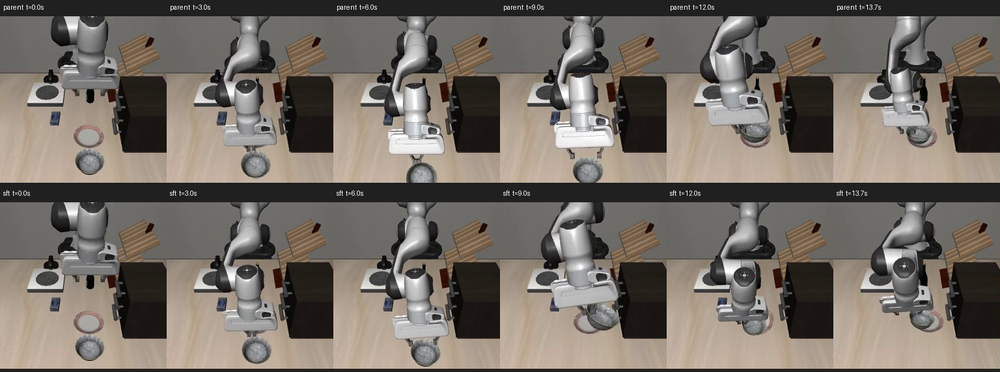
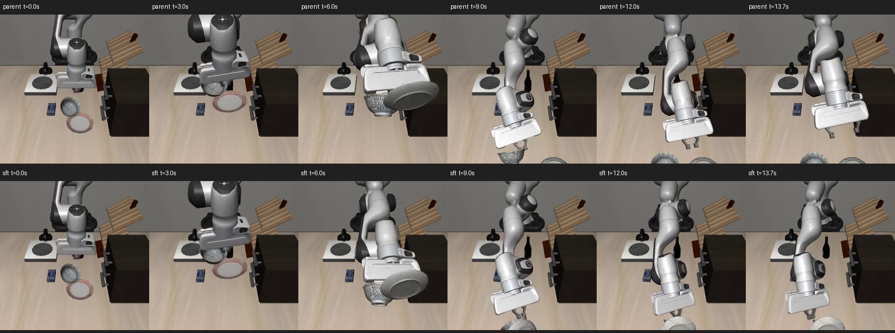

# 同场景恢复示范＋旧任务回放实验（2026-10-27）

本轮完成 2000 次真实 π0.5 LoRA 更新及训练前后配对仿真。**恢复能力没有提升，候选不晋级，不替换现用面板模型。** 新开发集由 6/12 降到 5/12，旧开发集由 10/12 降到 7/12；常规任务小样本仍为 8/8。

## 做了什么

上一轮人工纠错数据来自 LIBERO spatial 场景，本轮改为与评测相同的 LIBERO goal 场景、任务 8：`put the bowl on the plate`。只从训练源初态 ID1..6 收集已经训练过的 PPO 策略真正完成的恢复轨迹；这些是**模型自主生成的示范，不是人工纠错，也不是手写控制轨迹**。

18 个训练失败初态中收集到 13 条成功全程示范，共 1127 帧：抓空 5/6、物体偏移 6/6、放置失败 2/6。放置恢复只覆盖源 ID2、3。保存每一步动作前的双相机 RGB、8 维状态、7 维动作，以及原始命令与 MuJoCo 物理状态。

原始策略命令可能超出控制范围，因此同时保留原命令和裁剪到控制范围的训练标签；两套动作分别在独立仿真中完整重放，13/13 均通过，所有记录物理状态最大误差为 0.0，终态满足严格松爪目标。没有剪辑动作时序或加速训练标签。见 [入选数据及重放证据](../../evidence/matched-recovery-manifest-v1.json)。

本轮从原 40 任务 SFT 父检查点 `multitask40_lora_v1/9999` 开始，使用全新 AdamW，只更新 LoRA：2000 更新、batch=1、lr=5e-6、warmup=20、seed=42、无 EMA。抽样槽位为 25% 恢复／75% 旧数据，旧数据保留 40 任务、1525 条训练示范并按任务均衡抽样。含预取实际获取 543 个恢复窗口和 1458 个回放窗口，这不是精确的已更新样本比例。

**这一轮是 SFT，不是增加 PPO 更新量。** PPO 教师来自之前的奖励训练。训练正常退出 0，实际更新 2000 次，检查点为 `matched_recovery2000_v1/1999`；更新计时约 359 秒，另有输入哈希审计、加载、编译、导出及评测耗时。训练服务峰值内存约 36.75 GiB，48 GiB 上限下 OOM/OOM-kill 均为 0。见 [训练状态](../../evidence/matched_recovery2000_v1-status.json)、[曲线](training-loss.png)、[复现命令](commands.md)。训练 loss 不能替代仿真成功率。

## 固定评测与结果

训练前冻结 [计划](../../evidence/matched-recovery-evaluation-plan-v1.json)：新开发源 ID30..33 为主要比较，旧开发 ID20..23 为回归；各包含抓空、物体偏移、放置失败三类，共 12 场。原留出 ID10..13 保持隔离，本轮没有用它们选模型。开发评测不是盲测。

前后各 32 场均重新运行：24 个恢复场景＋8 个常规任务。初态物理状态、运行代码、非权重配置和推理噪声配对一致；控制 20 Hz，预测 10 步、执行 5 步再观察，流采样 10 次，最多 300 控制步，噪声种子 42。恢复成功要求原生任务目标成立，且无手指接触连续保持 5 个控制步；常规任务检查采用 LIBERO 原生判据，不能混为严格松爪验收。

| 检查 | 原 40 任务 SFT | 本轮候选 |
| --- | ---: | ---: |
| 新开发：抓空 | 2/4 | 2/4 |
| 新开发：物体偏移 | 3/4 | 3/4 |
| 新开发：放置失败 | 1/4 | 0/4 |
| **新开发合计** | **6/12** | **5/12** |
| 旧开发：抓空 | 4/4 | 3/4 |
| 旧开发：物体偏移 | 4/4 | 4/4 |
| 旧开发：放置失败 | 2/4 | 0/4 |
| **旧开发合计** | **10/12** | **7/12** |
| 常规任务 0/7/8/9 × 初态 0/10 | 8/8 | 8/8 |

新开发共同成功的 5 场，控制步中位数 85→84；旧开发共同成功的 7 场，81→86。不能用不同成功子集比较速度，也没有证据说明候选解决了“慢动作”。全部逐场结果见 [新开发对照](freshdev-comparison/comparison.json)、[旧开发对照](olddev-comparison/comparison.json)。

晋级规则要求新开发总数严格提高且每类不下降、旧开发总数及各类不下降、常规保持 8/8。本轮未通过。[逐场一致性、晋级及 88 段录像完整解码审计](audit.json)。

## 实际画面与失败分析

同步录像左侧 `before` 为父模型，右侧 `after` 为候选；恢复录像与对照均按 20 Hz 仿真时间播放，较早结束的一侧冻结末帧。常规任务原录像为 10 fps，20 Hz 的每个控制步都保留，因此是慢放，不应用它衡量真实运行速度。

- [放置 init30：父模型成功，候选失败](freshdev-comparison/comparison-dev-placement_failure-init30.mp4)。父模型 275 控制步完成，候选在 300 步超时；候选原生目标从未成立，末帧仍有手指接触，碗盘 XY 距离约 4.10 cm。不能把到达盘子附近当作完成或恢复成功。
- [抓空 init32：两者都失败](freshdev-comparison/comparison-dev-empty_grasp-init32.mp4)。实际画面中碗、盘被一起扰动，候选末帧 XY 距离虽约 2.27 cm，目标仍未成立，近距离不代表正确放置。
- [偏移 init33：两者都成功](freshdev-comparison/comparison-dev-object_offset-init33.mp4)，94→92 控制步，保留成功例作参照。
- 旧开发放置 init20、22 原本分别 222、84 步成功，候选均 300 步失败；抓空 init20 也由成功退化为失败。全部 24 组对照均保留，没有只挑好看的片段。

逐步轨迹也记录了末端位移。以单控制步末端位移 <0.2 mm 且原生目标未成立作低运动指标：候选新开发放置 init31 最长连续 16 步，即 0.8 秒仿真时间；init30 的失败不是这个阈值下的持续静止，而是动作仍在继续但未正确放置。这个指标看不到所有缓慢漂移，不能据此宣称用户先前遇到的停滞已经消失。

所有超时场景都实际执行到了 300 控制步（15 秒仿真时间）。这说明本轮失败不是成功判据过早触发；但本轮没有延长上限的对照，不能断言再给时间一定会成功或一定不会成功。

## 可以得出的结论与下一步

同场景数据和物理重放校验排除了上一轮的一个明显混杂因素，但只靠这 13 条成功示范没有带来开发集恢复提升。两条放置恢复示范覆盖窄，训练目标也不直接奖励闭环恢复成功；这与结果相符，**尚不能单凭本轮区分过拟合、示范覆盖不足、抽样比例或优化强度各自的贡献**。

下一轮应先针对失败状态扩展“接近错误→抬起脱离→重新对齐→抓取／松爪→稳定结束”的有效示范，保留旧数据回放，再做单因素的比例或更新数对照。不要把同一批窄数据直接多训几万步当成已知解决办法。新一轮开始前应另设新的开发初态；本轮开发集不能再声称是全新验证集。当前模型不替换，失败结果保留。

## 校验与备份

项目测试 `pytest -q tests`：43 项通过，80 条上游 Flax 弃用警告；备份恢复脚本 Ruff 检查通过。测试日志见 [run-logs](run-logs/)。

JAX LoRA 与合并 Torch 导出在固定合成输入、CPU float32 单步流采样上对照通过，最大绝对误差约 1.43e-6；严格加载也通过。该检查不证明 tokenizer、归一化、BF16 或十步完整策略逐位等价，实际闭环结果以本页仿真为准。[数值证据](../../evidence/matched-export-parity/parity.json)。

公开数据和推理 LoRA 权重发布在 [本轮 Release](https://github.com/sencangWei/pi05-rl-handson/releases/tag/matched-recovery-sft-20261027)。数据已独立下载，完整归档 SHA 及 42 个文件哈希一致：[数据恢复证据](../../evidence/matched-recovery-data-restore.json)。权重也从公开 Release 独立下载，185501122 字节的完整归档 SHA 一致；结合相同官方基座重构全部 71 个参数叶子（含 20 个 LoRA 张量），逐叶哈希全部通过：[权重恢复证据](../../evidence/matched-adapter-restore.json)。

代码、配置、报告和实际视频已备份至用户公开仓库 `sencangWei/pi05-rl-handson` 的 `experiment/matched-recovery-20261027` 分支。独立检出提交 `c739fb2dd0f0a546f9df3c14457de1b804942430`，1973 个跟踪文件的工作内容、远端 blob 与树哈希逐一一致：[代码与视频恢复证据](../../evidence/matched-final-remote-files.json)。实际算法涉及的忽略目录 RLinf 也在固定干净上游重放 9 个补丁，12 个运行文件一致：[运行时恢复证据](../../evidence/matched-final-remote-runtime.json)。常规评测借用的旧模拟器源码也与用户公开仓库的固定提交逐字节一致：[外部模拟器核验](../../evidence/matched-external-simulator-restore.json)。最后这批核验记录另作元数据提交，不改变上述已核验算法版本。

完整训练检查点及优化器保留在本机。Release 的紧凑 LoRA 包只用于恢复推理参数；需要相同官方 `pi05_libero` 基座，不等于完整离线训练环境。未上传官方大基座、全部公开数据或 Python 虚拟环境。本轮未改旧项目、未触碰真机。
