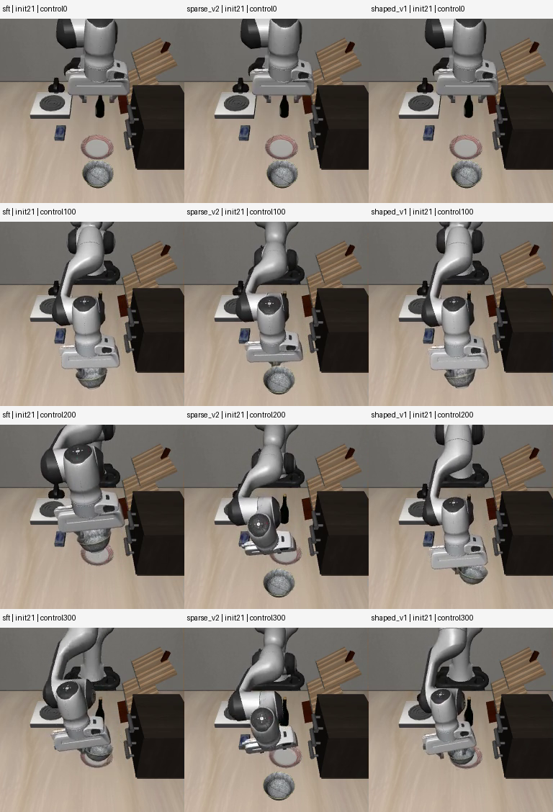
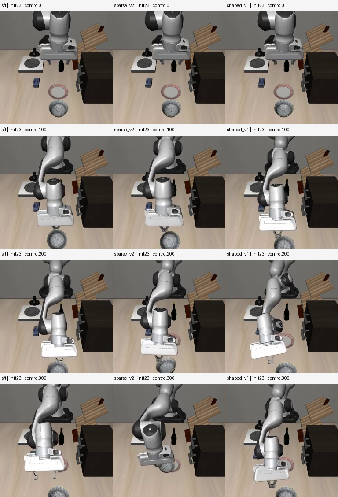

# 恢复奖励对照实验（2026-10-27）

状态：两组训练和独立对照已完成。内存退出问题在本轮验证中未再出现，但恢复奖励没有提高开发集成功率，且成功回合更慢；面板现用模型未替换。

## 本轮检验什么

上一轮真实 300 次 PPO 更新与冻结 SFT 在旧留出初态都为 9/12，放置失败恢复只有 1/4，不能据此声称增加更新就有效。本轮保留这些历史结果，用新开发初态做奖励消融。

实际发现并修正两个问题：

1. LIBERO 向量环境丢弃子环境的 reward 并重新计算稀疏奖励，所以仅修改子环境不能让恢复奖励进入 PPO。现在在实际 `chunk_step` 奖励张量中注入恢复进展奖励。
2. 一个动作窗口执行完之前可能已经成功；原奖励没有屏蔽首次结束之后的槽位，可能重复计奖。两组新配方都屏蔽这些奖励，保留旧配方作为历史记录。

## 固定实验协议

| 项目 | 设置 |
|---|---|
| 模型 | π0.5，冻结 multitask40 SFT 合并权重为共同父模型，新增 PPO LoRA/value head |
| 父权重 SHA256 | `4526e30c6aa11108a3331f7f4ae7931394629961df42736deedd7169ec154d5f` |
| 训练初态 | 源 ID 1..6 × 抓空/物体偏移/放置失败，18 个物理初态 |
| 开发初态 | 新源 ID 20..23 × 同三类，12 个；不加入训练 |
| 旧留出初态 | ID 10..13 隔离，不在本轮重跑或调参 |
| 两组训练量 | 各 20 轮 × 15 次有限优化器更新 = 300 次；随机种子 42 |
| 优化器 | 策略 lr 5e-6，value lr 1e-4，global batch 2，micro batch 1 |
| 资源上限 | 单 GPU 顺序运行；每个作业 RAM 48 GiB、swap 0、时限 2400 秒 |
| 独立评测 | 固定噪声，每次观察后执行 5 个控制步，10 次流推理，最多 300 控制步 |
| 成功判据 | LIBERO 原生目标成立且手指不接触碗，连续 5 个控制步 |
| 视频 | 双相机原视频、逐控制步轨迹、同初态三栏并列，20 fps 仿真时间 |

两组均从 SFT 开始，不接续上一轮 PPO。`sparse_v2` 只有修正后的稀疏奖励；`shaped_v1` 在相同设置下增加 `0.3 * (0.99 * Phi(next) - Phi(current))`。Phi 使用靠近、真实双指抓持、抬升、搬运对齐和原生放置进展；模拟器物体位姿只用于训练奖励，未增加到模型观测，也未编写恢复轨迹。

PPO 在动作窗口内求和，只在窗口之间折扣一次。真正终止时末端势能置零；超时使用终态价值 bootstrap，因此保留末端势能。悬停不会不断获得正奖励，抬起后退回的收益会抵消。设计参考 [Ng、Harada、Russell 的 potential-based reward shaping](https://people.eecs.berkeley.edu/~pabbeel/cs287-fa09/readings/NgHaradaRussell-shaping-ICML1999.pdf)。这保证的是奖励设计边界，不能保证短训练会学会恢复。

`evidence/recovery27-stage-protocol.json` 在训练前冻结配置、源码、数据及选择规则：总成功数、各类成功数均不降低，成功回合控制步中位数不增加，否则保留 SFT。这里只有一个训练随机种子和 12 个开发初态，不作为全任务泛化结论。

## 最终结果

| 模型 | 实际 PPO 更新 | 独立开发成功 | 抓空 | 偏移 | 放置失败 | 成功回合控制步中位数 | 正常退出 / OOM |
|---|---:|---:|---:|---:|---:|---:|---|
| 冻结 SFT | 0 | 10/12 | 4/4 | 4/4 | 2/4 | 87 | 评测退出 0 |
| sparse_v2 | 300 | 9/12 | 4/4 | 4/4 | 1/4 | 97 | 退出 0 / 0 次 |
| shaped_v1 | 300 | 10/12 | 4/4 | 4/4 | 2/4 | 97.5 | 退出 0 / 0 次 |

两组峰值 RAM 分别为 42.89 GiB、38.60 GiB，均在 48 GiB 限制内完成 20 轮、300 次有限优化器更新并保存。550 个保存张量有限；优化器状态中 242 个 step=300、308 个 step=0，因此不声称全部注入的 LoRA 都得到更新。原始证据见 [sparse 运行记录](../../evidence/recovery27-sparse-v2-run.json)、[shaped 运行记录](../../evidence/recovery27-shaped-v1-run.json)。

三个模型共同成功的 9 个场景，控制步中位数为 84 / 97 / 90；即使统一成功场景集合，也没有整体提速证据。两组均未通过训练前冻结的模型选择门，不自动替换现用模型。只有一个 seed、少量初态；结果不能证明奖励路线无效，也不能证明继续加步数会有效。

[逐场完整结果](development-comparison/comparison.json)；[36 段原视频和 12 段三栏对照的验证](../../evidence/recovery27-stage-comparison-validation.json)。三栏从左到右为 SFT / sparse_v2 / shaped_v1，按相同控制步同步，先结束的画面冻结，保留全部失败。

- [放置初态 20：SFT 成功 / sparse 失败 / shaped 成功](development-comparison/comparison-dev-placement_failure-init20.mp4)
- [放置初态 21：三模型均失败](development-comparison/comparison-dev-placement_failure-init21.mp4)
- [放置初态 23：三模型均失败](development-comparison/comparison-dev-placement_failure-init23.mp4)

## 失败画面与训练初态诊断





逐步轨迹与画面一致：shaped 的初态 21 在全部 300 控制步中从未满足原生放置目标，176 步存在手指接触，最终碗盘 XY 相距约 3.06 cm；初态 23 也从未满足目标，最终相距约 24.07 cm，碗被推远。这两场不是“已经正确放置，只差结束按钮”，也不能把超时等同于机械臂完全静止。[测量记录](development-failure-analysis.json)。sparse 的初态 20 曾触发原生目标，但最终仍接触碗，严格松爪判据正确阻止误报成功。

主对照结束后，在同一冻结源码下，另对训练用的 6 个放置失败初态做成对诊断：SFT 0/6，shaped 2/6，成功初态 02/03 分别 115/114 控制步。这是训练分布内的局部改善，不能代替独立开发集提升，也未对 sparse 做该项诊断，不能单独归因于恢复奖励。

[6 场训练初态双栏对照](training-placement-final/comparison.json)；[成功初态 02](training-placement-final/comparison-train-placement_failure-init02.mp4)、[成功初态 03](training-placement-final/comparison-train-placement_failure-init03.mp4)。两段实际模型成功视频和动作轨迹的 [导出清单](training-placement-final/successful-training-clips.json) 只引用 train 初态，不包含开发集；未将它们加入新一轮训练。这些是视频与轨迹证据，尚不是包含训练观测—动作对的模仿学习数据集。

后续有依据的方向：从反复失败的状态族采集正确的完整恢复示范，保留旧数据回放，覆盖抬起重抓、持碗重新对齐、放稳后松手；再次训练前固定新的评测初态。当前只证明两组配方的结果，不启动无限追加更新，也不把这两段训练场景成功称为泛化恢复。

## 训练前证据

- SFT 新开发集 10/12：抓空 4/4，偏移 4/4，放置失败恢复 2/4。
- 旧训练放置初态探索诊断 0/6，均没有达到原生放置判据；不是单纯完成后不松手。该作业启动后代码发生过改动，仅作为探索证据，见 `train-placement-sft/PROVENANCE_NOTE.txt`。
- 实际子进程 smoke 检验恢复奖励到达 PPO 输入，误差在浮点容差内；六项奖励/终止边界回归通过。
- 项目要求的 CPU 数值校验环境中全套 19 项测试通过。未限定环境的第一次全测有 1 项 JAX/GPU 数值误差，原日志保留，没有放宽阈值。
- 第一条启动命令因脚本没有执行位被拒绝，未启动训练；后续明确用 `bash scripts/run_ppo_smoke.sh`，失败日志保留。

## 可复现命令

在仓库根目录，准备好已固定版本的环境、公开数据和冻结父权重后执行；绝对路径参数需要按本机目录调整。脚本检查初态、父权重哈希、数值精度、adapter 保存和同步后才启动训练。

```bash
JAX_PLATFORMS=cpu .venv-ppo/bin/python -m unittest discover -s tests -v
.venv-ppo/bin/python scripts/check_recovery_shaping.py
PPO_CONFIG=ppo_recovery_sparse_v2 bash scripts/run_ppo_smoke.sh
PPO_CONFIG=ppo_recovery_shaped_v1 bash scripts/run_ppo_smoke.sh
```

两组按顺序运行，每组建议沿用本轮 systemd 的内存和时限设置。各模型独立评测使用相同的 composed 配置：

```bash
.venv-ppo/bin/python scripts/evaluate_recovery.py \
  --split dev --manifest data/recovery-bowl-dev27/manifest.json \
  --config evidence/ppo_recovery_sparse_v2-composed.json \
  --checkpoint exports/pi05-recovery27-shaped_v1-adapter.pt \
  --output evaluations/recovery27-dev-shaped_v1
```

不传 `--checkpoint` 为冻结 SFT；sparse 模型改为相应 adapter 和一个新的输出目录。脚本拒绝覆盖已有结果。实际顺序、系统退出、更新计数、内存采样及检查点校验见 `evidence/recovery27-*`。

## 备份与边界

实际算法位于被主仓库忽略的 `third_party/RLinf`，不能只备份外层脚本。本轮通过第 9 个有序补丁 `configs/rlinf-recovery-shaping.patch` 保存改动；从用户远端恢复后，在固定干净上游重放 9 个补丁，核对 12 个实际运行文件的 SHA256。代码已经从用户远端独立恢复核对；最终运行证据和媒体一并提交。具体版本和文件 SHA 见 [远端文件核验](../../evidence/recovery27-stage-final-remote-files.json)、[算法重放核验](../../evidence/recovery27-stage-final-remote-runtime.json)。

没有改动旧训练工程、旧面板或真机。未验证 40 任务遗忘、中文连续指令、未知物体泛化、真机或稳定家庭产品能力。开发集视频不能当作新的训练示范，以免泄漏。


两组 adapter 与校验和发布在 [公开 Release](https://github.com/sencangWei/pi05-rl-handson/releases/tag/ppo-recovery-shaping-20261027)，均需匹配上述冻结基座，不能单独运行。两份权重已分别从 Release 独立分段下载、核对每段范围与长度并比对完整 SHA256：[sparse 证据](../../evidence/recovery27-stage-release-pi05-recovery27-sparse_v2-adapter-restore.json)、[shaped 证据](../../evidence/recovery27-stage-release-pi05-recovery27-shaped_v1-adapter-restore.json)。未上传约 13 GB 基座、虚拟环境或全部原始数据。
