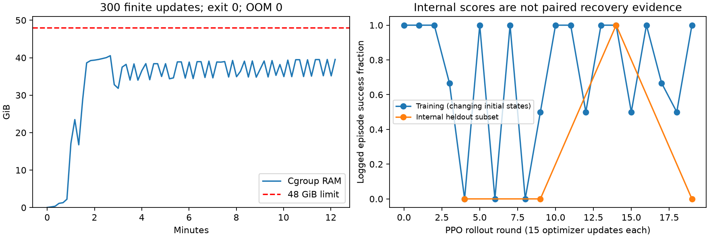
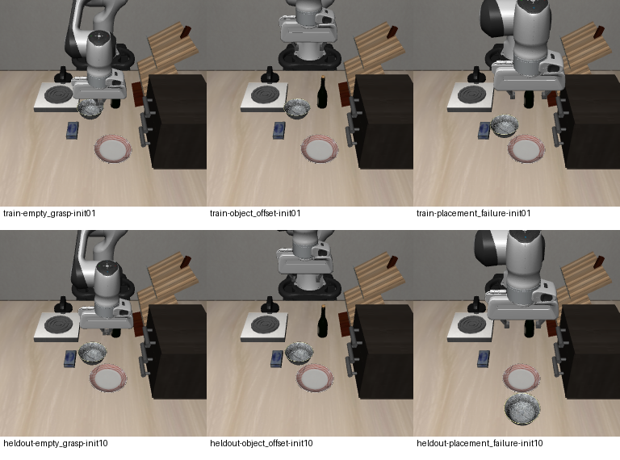

# 内存修复与失败恢复专项（执行中）

目标：解决保存后退出OOM，将上一轮30次PPO更新扩展至300次，并用抓空、物体偏移、放置失败初态专门检验恢复。仅本地MuJoCo/LIBERO仿真，不替换旧面板模型。

## 已验证的内存修复

FSDP的`_local_shard`与`flat_param.data`本来共享存储；旧卸载/装载路径分别复制后又重绑定，导致重复分配。现在只移动一次，再恢复别名。CUDA三次CPU/GPU往返回归检查参数、梯度、输出和存储转移，见 [别名回归](../../evidence/ppo-fsdp-offload-alias.json)。

完整π0.5模型3轮、45次有限优化器更新后正常退出0，峰值40,945,025,024字节（38.13GiB），48GiB内存上限、禁用swap，OOM事件0，见 [完整模型结果](../../evidence/ppo-offload27-summary.json)。Ray本机CPU预算限制为4，减少预启动worker；它不等于限制全部原生线程数。新300次运行也正常退出0，峰值43,674,345,472字节（40.68GiB），OOM0；[最终检查点证据](../../evidence/ppo-recovery27-checkpoint.json)核对242个优化器状态step=300，另308个为0，550个保存模型张量均有限。不能声称全部注入LoRA都得到更新。



内部抽测4次成功率0、0、1、0，状态随抽测变化，不构成配对提升证据。18个训练状态均实际访问；训练reset次数按三类为15/15/14（含自动重置），不等于完整episode数。独立12场景结果待结算。

## 初态与判据



- 抓空：夹爪在原碗位置上方闭合，碗已挪到旁边，需要重新接近并抓取。
- 物体偏移：从原机械臂初态开始，碗发生位置偏移。
- 放置失败：碗落在盘子附近的桌面，机械臂在盘子上方，需要再次抓起并放置。

这是合成物理状态，不是从某个失败录像倒推的完整历史。构造阶段用OSC控制移动机械臂、扰动物体，稳定10步，排除初始成功、夹爪接触、物体飞起或严重漂移；构造动作不会进入训练或评测策略。恢复阶段全部动作由π0.5模型输出，无脚本恢复轨迹。

训练使用官方初态ID1至6，各3类共18个；留出ID10至13，各3类共12个。训练偏移目标4cm，留出5.5cm；放置失败距盘子中心13/15cm。为避免碰到旁边物体，构造器会尝试替代方向；真实偏移和请求偏移均在 [manifest](initial-bank/manifest.json) 逐项记录，不能声称覆盖所有正负象限。原始npz、状态哈希和截图一并保存。

严格成功：LIBERO原生碗在盘子目标成立，并且目标碗无手指接触，连续保持5个控制步。失败保留超时、异常和逐步轨迹；不是一接触盘子就通过。

## 训练方案与评测协议

从本轮40任务SFT合并权重开始，独立初始化PPO LoRA；不接续此前30更新adapter，因为这轮改变了初态与成功奖励。固定20轮、每轮15次优化器更新，共300次。batch2、microbatch1，动作窗口10；actor学习率5e-6、value head1e-4，余弦调度按20轮推进。奖励为严格成功1、每控制步减0.001，保持上轮PPO算法及模型接口。

训练从18状态循环取样，逐次记录实际状态ID；留出状态不参与梯度更新。每5轮的内置评测可能访问留出子集；最终固定选第20轮，未据留出成绩调参或挑选checkpoint。独立对照计划在同12个状态、同随机噪声、每次预测执行5步、最多300控制步下比较SFT、旧30更新PPO、新300更新PPO。独立推理使用10次flow求解；训练采样保留现有5次求解，比较各模型时保持一致。

该设计只检验单一放碗任务的三类恢复初态，不证明通用家庭指令、长期记忆、40任务无遗忘或真机能力。

```bash
MUJOCO_GL=osmesa PYOPENGL_PLATFORM=osmesa CUDA_VISIBLE_DEVICES= \
  .venv-ppo/bin/python scripts/check_recovery.py
PPO_CONFIG=ppo_recovery bash scripts/run_ppo_smoke.sh
.venv-ppo/bin/python scripts/evaluate_recovery.py --output evaluations/recovery-sft
.venv-ppo/bin/python scripts/evaluate_recovery.py \
  --checkpoint exports/pi05-ppo-20261026-30updates-adapter.pt \
  --output evaluations/recovery-old30
```

源码实际位于忽略的RLinf克隆中；8个有序补丁及12个运行文件哈希存入 [运行时清单](../../evidence/ppo-runtime-patch-manifest.json)，干净上游恢复检查已通过。大型冻结权重不纳入git。
