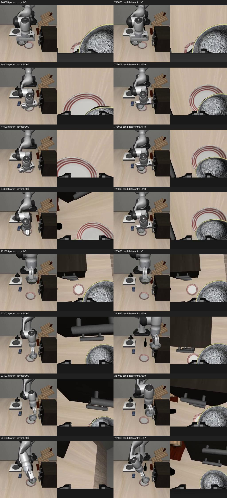

# 专家完整初态：父模型与补充微调模型对照

状态：COMPLETE。四次真实模型仿真已完成；新增两段监督在这两个训练初态下有效，但慢动作和跨初态恢复仍未解决。没有新增训练、PPO或面板模型切换。

## 同初态结果

| 人工示范来源 | 父模型，最多600步 | 新模型，最多600步 | 新模型300步内 | 专家参考首次稳定松手步 |
|---|---|---|---|---:|
| `human_1793121358375746008` | 未通过，600步 | **成功，118步** | 成功 | 463 |
| `human_1793122696228231033` | 未通过，600步 | **成功，562步** | 未通过 | 395 |

600步窗口父模型0/2、新模型2/2；预先冻结的300步里程碑父模型0/2、新模型1/2。所有失败保留。这是两条**参与训练的专家初态**，每个模型每个初态只跑一次，不能将2/2当成未知场景成功率，也不能替代上一轮12例开发评测。

成功要求LIBERO原生目标成立，且连续5控制步没有碗与夹爪接触。父模型第一条第172步短暂满足原生目标，但没有连续5步脱离接触，最终碗离开目标区域；第二条从未满足原生目标。新模型两条均实际达到连续5步无接触的原生目标。

左=父模型，右=新模型，各侧包含外部相机与腕部相机。20fps，对应20Hz原始控制时间；先结束的一侧明确标为FROZEN并冻结末帧，不加速动作。

- [第一条左右同步录像](../../artifacts/20261029-expert-policy/comparison-human_1793121358375746008.mp4)
- [第二条左右同步录像](../../artifacts/20261029-expert-policy/comparison-human_1793122696228231033.mp4)

## 慢在哪里

第二条新模型第401–500步，末端平均每步位移0.729毫米，100步全程仍有夹爪接触；这段之前第301–400步为1.535毫米。最终第558步才首次达到原生目标，第562步通过稳定松手检查。因此不是“已经完成却被检查多等了几百步”，搬运/对位阶段本身仍慢。

本次热启动后每次10步动作推理的中位耗时约64–65毫秒。第二条562步为28.1秒**仿真时间**，无界面批量运行墙钟约14.06秒；首个推理另有JIT冷启动，第一条墙钟包含该耗时。这些数值不能代替交互面板的响应延迟测量，也不能证明用户此前几分钟的等待已经解决。

本次低运动指标为末端单步位移小于0.2毫米且未满足原生目标；第二条新模型最长连续4步。可见它在缓慢推进，不是这一阈值下长时间完全停滞；0.729毫米/步也不能单独判断碰撞、动作幅值或策略犹豫的具体原因。逐100步数据见 [分析JSON](../../evidence/expert-policy29-analysis.json)。

## 初态与动作契约验证

冻结协议在任何策略执行前生成。父/新模型每条都从新建仿真进程恢复**同一个完整快照**，包括物理状态、控制器内部状态、nullspace anchor、夹爪、缓存和随机状态。输入不是只恢复机械臂关节位置。

- 第一条为`snapshot-73.npz`，初始碗与夹爪有接触，但robosuite双侧grasp判据为false；不能将两条一概称为“已稳定抓牢”。第二条为`snapshot-223.npz`，初始grasp=true且有接触。
- 四次初始物理状态、8维观测和两路实际RGB都与审核通过的监督数据首帧**逐值/哈希完全相同**；控制器缩放、nullspace anchor及仿真模型/版本身份检查通过。
- 20Hz，动作窗口10步、每次执行前5步再观察，flow采样10步；seed42，每次推理噪声种子42+调用下标，逐场重置。双方相同600步上限，并同时报告300步里程碑。
- 模型输出7维OSC动作。除首次匹配数据首帧的观测刷新外，后续使用普通`env.step`返回观测；无专家后续状态注入、无专家动作重放、无脚本恢复。每步记录动作、接触、抓取、目标判据、物理状态及录像。
- 两个权重目录的全部参数文件与归一化文件，在运行前后重新校验SHA256；代码与输入文件哈希也逐场校验。

专家参考首次稳定松手为463/395步，超出300步；因此本诊断提前冻结600步预算，而没有看到模型结果后才延长。旧12例评测的300步上限保持原样，两批结果不可直接合并计算成功率。

父模型：`checkpoints/pi05_multitask40_lora/multitask40_lora_v1/9999`；新模型：`checkpoints/pi05_recovery_replay_lora/osc_expert_replay2000_v1/1999`。新模型沿用此前2000次监督LoRA更新，本次没有再训练。权重及数据来源见[上一轮报告](../osc-sft-20261029/README.md)。

## 诊断结论与下一步

数据通过执行回放并经人工认可，现在真实策略在两个训练初态上也能够完成，因此“这些监督根本不能用/完全没学会放置”不符合本次证据。结合上一轮同协议开发集父9/12、新6/12、四个放置失败初态新模型0/4，本轮更支持**局部放置技能有学到，但进入该技能的状态覆盖和阶段衔接不足，且仍有慢动作**这一工作假设。

这还不是原因隔离实验：只有两个训练初态和一个种子，不能证明就是某一段数据、过拟合、抽样比例或学习率导致，更不能直接声称已经具备恢复泛化。

下一轮优先检查已有公开完整示范与人工记录中“接近→稳定抓取→抬起→搬运”的连续窗口，保留旧数据回放，对照阶段抽样与损失覆盖，再设计有界微调。先不要求用户反复录不同坐标；若已有数据确实缺失某类恢复，再定向补录。是否晋升仍以同一套12例开发回归及普通任务保留评测为准，不能因为这两条训练初态成功就切换面板。

## 文件、检查与复现边界

- [执行入口](run.py)、[策略诊断代码](../../scripts/evaluate_expert_snapshots.py)、[分析和录像生成](analyze.py)、[命令说明](commands.md)。
- [冻结协议及全部权重哈希](../../artifacts/20261029-expert-policy/protocol.json)、[四次结果](../../artifacts/20261029-expert-policy/summary.json)、各模型/来源目录中的`identity.json`、`trace.jsonl`、`states.npz`及`policy.mp4`。
- [运行环境](../../evidence/expert-policy29-environment.json)：`.venv-ppo`用于仿真，`.venv-train`用于推理；文件名ppo不表示本次运行PPO。环境记录删除不相关的全仓文件枚举，仅保留允许的环境变量；具体启动变量见执行入口。源代码父提交`e4c1c1bc61e4277609560876f37ea1022b82aae4`加协议内新文件内容哈希确定执行版本。
- 新增6项守卫测试（含两路相机子测试）通过，覆盖物理/观测/相机/输入/权重变化拒绝。4条轨迹共1880控制步及其状态时间线、动作与噪声编号、成功计数重新核对通过；6个视频全解码，共3086帧。限定范围Ruff和Python编译检查通过。测试日志见`logs/expert-policy29-checks.log`。
- 独立systemd任务正常退出：`Result=success`、`ExecMainStatus=0`。测试专用父/新推理服务均已关闭，没有停止其他GPU任务或触碰真机。

2026-10-29 远端备份验收完成：载荷 `ed04356f98d12ba74a0124d28b87063bccd8cccd` 已推至自有公开仓库 `sencangWei/pi05-rl-handson` 的 `experiment/matched-recovery-20261027` 分支。独立恢复全部 3688 个跟踪文件，逐文件 SHA256 和重建 Git 树 `014cae4fccc987e762c76e70682ce302d3b1ea46` 精确一致；48 个缓存外 Git blob 从远端下载并校验。证明见 [远端恢复记录](../../evidence/expert-policy29-final-remote-restore.json)。代码、冻结配置、四条真实轨迹、六段录像和报告均已备份；本轮未改检查点，权重沿用上一轮 Release 备份。
