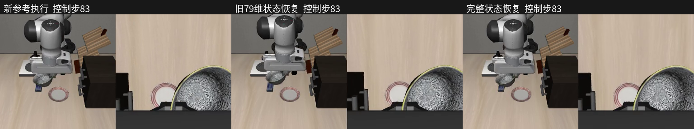

# 完整仿真状态恢复：短接触对照

2026-10-28。结论：在两条混合控制动作的4个窗口中，完整状态恢复后，181个控制步的 time/qpos/qvel、缓存位置、接触与任务标志、双相机原始像素均与**新生成的参考执行**完全一致。旧79维恢复4/4不通过。验证的是离线复现基础，模型恢复能力尚未修好，未重训或替换面板模型。

## 对照结果

| 恢复方式 | 严格数值保真 | 物理状态逐位一致 | 标志和原始像素全部一致 |
|---|---:|---:|---:|
| 旧 time/qpos/qvel（79维） | 0/4 | 0/4 | 0/4 |
| 仅原生 MjData | 0/4 | 2/4 | 0/4 |
| integration 状态 + Python 状态 | 4/4 | 4/4 | 4/4 |
| 完整 MjData + Python 状态 | 4/4 | 4/4 | 4/4 |

严格门：qpos≤1e-6、qvel≤1e-5、缓存位置坐标误差≤1e-5m。完整恢复的以上误差实际全部为0.0。原始像素SHA来自编码视频前图像，不把有损MP4解码像素当作原始SHA。全部4窗口含103个参考手指接触控制步；接触代理不等于稳定抓持真值。

旧79维在6008的首窗口最大qpos误差0.042738、qvel误差2.288279、缓存位置坐标误差16.191mm。另两个末段窗口物理状态虽很接近，缓存位置仍有约5–6mm偏差。仅恢复物理量不足，不能据此把原因唯一归为warmstart；integration+Python在当前“每控制前刷新观测”的执行契约下也完全一致。

## 录像

三栏依次为新参考、旧79维恢复、完整恢复；每栏分别包含外部相机和腕部相机。均保持20Hz，不加速、不插入保存的后继状态。

- [6008：OSC转关节，73–108](v1/comparisons/6008-73-109.mp4)
- [6008：最后关节转OSC，517–563](v1/comparisons/6008-517-564.mp4)
- [1033：OSC转关节，223–258](v1/comparisons/1033-223-259.mp4)
- [1033：最后关节转OSC，595–656](v1/comparisons/1033-595-657.mp4)



## 实验契约与复现

原始两条源记录为 human_1793121358375746008、human_1793122696228231033；身份由既有 manual-recovery28-manifest 和 replay_mixed_correction.load_source 校验。原始示范未改写。各执行564/657控制步生成一次新参考，在首次关节前12步和最后一次关节前保存快照；每个窗口和每种恢复方式使用新进程。共1221参考控制+724恢复控制，18段原录像；另生成4段三栏录像。

实际运行：Python3.11.15、MuJoCo3.8.1、robosuite1.4.1、NumPy1.26.4，20Hz控制、0.002s物理步长，LIBERO goal8。实际环境见[runtime.json](runtime.json)、两源 identity.json；evidence/full-state28-environment.json是系统Python的发现阶段记录，不代表worker运行环境。

```bash
cd /home/robot/pi05-rl-handson
PYTHONPATH=/home/robot/voice-arm-sim/.local/openpi/third_party/libero \
MUJOCO_GL=egl PYOPENGL_PLATFORM=egl CUDA_VISIBLE_DEVICES=0 \
OMP_NUM_THREADS=2 OPENBLAS_NUM_THREADS=2 TORCH_FORCE_NO_WEIGHTS_ONLY_LOAD=1 \
.venv-ppo/bin/python -u scripts/verify_simulation_snapshot.py \
  --output reports/full-state-replay-20261028/new-run
.venv-ppo/bin/python scripts/render_snapshot_comparisons.py \
  reports/full-state-replay-20261028/new-run
```

输出目录必须不存在。固定模式/源/容差/脚本SHA见[v1/protocol.json](v1/protocol.json)，逐场结果见[v1/summary.json](v1/summary.json)，原日志见[run.log](run.log)。快照包含版本相关原生二进制，只恢复本项目可信本地生成文件；npz禁用Python pickle。

## 代码修复与边界

- 新增离线快照，保存原生物理数据、控制器目标和缓存、夹爪累积量、机器人缓冲、观测缓存和采样相位、计数和RNG。模型XML、运行库版本和控制器身份必须一致；只支持单臂无插值OSC边界，不在临时关节jog中捕获。
- 实测MuJoCo3.8.1中，在已初始化MjData上调用__setstate__会静默不恢复。改用未初始化对象恢复，再mj_copyData写入现有句柄；有回归测试覆盖。完整恢复不额外forward或reset_goal。
- 旧录制只有time/qpos/qvel，丢失的原始内部状态不能倒推。因此本次成功**不推翻**上轮旧轨迹严格保真失败，也不是旧录制已经修好。
- 尚未将完整快照接入采集面板；没有生成关节→OSC训练标签、没有新模型训练、没有真机运动。
- 下一项应先在这些可复现快照上验证7维OSC是否能表达关节接管的搬运/肘部避障，并测实际跟踪误差；不能直接把关节动作当成OSC标签。若表达能力不够，需调整控制表示或重新采集兼容动作，而非继续增加同类位置示范。

## 验证与备份

40项相关测试通过，范围Ruff与Python编译通过；22段视频逐帧解码与预期长度核验见[verification.json](verification.json)。独立审查角色因本机配置模型不支持未能启动，本轮为直接源码检查和独立进程物理验证。备份状态以evidence/full-state-replay-28-remote-restore.json为准；缺少该文件时不得称远端恢复已通过。
