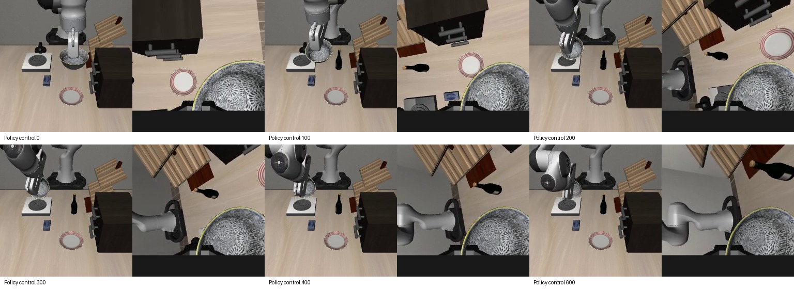

# 7关节动作表示：有界实测对比（2026-10-29）

当前建议：原始记录与执行采用**7个绝对关节目标角＋夹爪**；训练优先继续验证**相对当前观测关节角的目标偏移＋绝对夹爪**。暂不切换关节速度。**本轮没有实测胜者，两种模型均0/2，不替换操作面板模型。**

## 实际结果

两种模型各200次LoRA更新、batch=1、seed=42、同一官方π0.5 LIBERO父模型、同一条训练示范、相同200个抽样窗口顺序，另一整条示范留出。每次预测10步、执行第1步后重新观测；上限600个控制步，20Hz。成功需原生放置目标成立，且连续20步没有手指接触。

| 动作表示 | 训练场景闭环 | 留出场景闭环 | 结论 |
| --- | --- | --- | --- |
| 绝对关节目标角 | 执行2步，第3次预测J4越上限 | 第1次预测J7跳变1.424rad，超过0.35rad门限，执行0步 | 0/2，未学好新姿态 |
| 相对观测关节角的目标偏移 | 第1次预测J4越上限约0.000599rad，执行0步 | 执行600步，未达到目标，也未出现打开夹爪的负值命令 | 0/2，避开初始大跳变，但没有学会完成放置 |
| 关节目标速度 | 未训练 | 未评测 | 当前没有配套的速度控制器及实际下发速度标签，不能判胜 |

相对角留出场景的第1步最大目标跳变0.03047rad；J7目标2.24955rad，贴近当前2.24849rad，避免直接回到训练示范约0.82rad的姿态。它之后持续夹持，最后100步均报告grasp=true，单步末端位移中位数约0.91mm，原生目标成立0步。因此“能连续运行”不等于任务成功。

训练场景的J4初态为-0.0698223rad，紧邻上限-0.0698rad；相对角模型预测-0.0692007rad，被原有检查拦截。没有放宽上限、静默裁剪关节、跳过预测或加入专家动作。训练场景失败不是控制预算用完；留出场景确实到600步上限，但整个过程中目标成立0步，不能据此认定仅延长上限即可成功。

[实际留出视频](residual-v1/holdout-eval/policy.mp4) · [完整指标](summary.json) · [原始轨迹](residual-v1/holdout-eval/trace.jsonl) · [绝对角基线](../joint-pilot-20261029/README.md)



## 具体怎样定接口

1. **采集不丢信息**：记录实际下发的7关节绝对目标（rad）、实际关节位置（rad）、速度（rad/s）、夹爪命令与实际位置、末端位姿、主视角、腕部图像和同步时间戳。保留全部7关节，就能保留肘部调整。
2. **底层执行不混用含义**：继续使用已验证的位置PD控制，20Hz，KP=150、KD=2√150。末端摇杆经IK得到关节目标；单关节按钮也生成同一种关节目标，经过同一个执行记录接口。
3. **模型训练候选**：`r[t,k] = q_target[t+k] - q_observed[t]`。未来10个目标都减去**同一个当前观测**，不是逐步相减。
4. **推理解码**：`q_target[t+k] = q_observed[t] + r[t,k]`，恢复绝对目标后通过原有关节范围、跳变检查。夹爪不相减、不累加。重新观测后使用新的锚点，不能一直使用最初姿态。

比如当前J4=-1.0rad，下一目标=-1.1rad，训练标签是-0.1rad；执行时恢复成-1.1rad。这仍是“位置目标”，不是速度。速度还需要明确保持时长、积分/伺服方式、限速和实际下发速度，不能直接拿测量qvel当命令替代。

## 已验证与局限

- 专家目标编码→解码→同一控制器物理回放：两条共965步；每步物理状态最大误差4.16e-11，最终各连续20步目标成立且没有手指接触。[回放证据](expert-replay.json)
- 所有482个训练窗口和425个留出窗口的float32标签往返误差≤1.87e-9rad。原始数据不改写，留出数据不参与归一化和梯度。
- 51项针对性测试通过；新增文件Ruff通过。检查了共同锚点、夹爪保留、无输入篡改、非有限数、关节范围及跳变拦截。[验证记录](verification.json)
- 相对角实际完成200次训练更新，耗时115.85秒（含保存）。**这只是接口短训，不足以证明能学好关节控制。**
- 两条源数据是先前从轨迹重建的候选关节目标，经物理重执行后配对新图像；不是原始历史人工关节命令，不能混淆。
- 绝对角归一化每个训练运动帧计一次；相对角按所有完整窗口统计。两者统计权重不同，因此本轮不是完全隔离所有其他变量的消融；绝对角也未新跑另一随机种子。
- 只有1条训练、1条留出示范，且留出J7姿态远离训练范围。不能由此证明相对角已获得泛化/恢复能力，也不能把失败全部归咎于动作表示。
- 原π0.5 LIBERO权重的末端动作语义不能直接解释为关节目标。模型输出维数可容纳新表示，不等于现有动作能力会自动迁移。

## 本轮文件与复现

新增实现：[残差表示](../../scripts/joint_residual.py)、[冻结/训练/服务/评测入口](../../scripts/compare_joint_residual.py)、[专家物理回放](../../scripts/verify_joint_residual_replay.py)、[针对性测试](../../tests/test_joint_residual.py)。旧控制器、旧评测器及原始训练源文件没有修改。

冻结配置：[plan.json](residual-v1/plan.json)，SHA256 `034d8cc96fb60b3316abdc530209f9afba6f3f0a50c3dc99cf7ea81cbff546e0`。训练日志、样本索引、归一化、checkpoint文件哈希与评测视频均在`residual-v1/`。

本机复跑服务和留出评测（两个终端；评测输出需选新的目录；本轮服务已关闭）：

```bash
cd /home/robot/pi05-rl-handson
XLA_PYTHON_CLIENT_PREALLOCATE=false HF_HUB_OFFLINE=1 \
.venv-train/bin/python -u scripts/compare_joint_residual.py serve \
  --manifest reports/joint-choice-20261029/residual-v1/manifest.json \
  --plan reports/joint-choice-20261029/residual-v1/plan.json --port 9878
```

```bash
cd /home/robot/pi05-rl-handson
MUJOCO_GL=osmesa PYOPENGL_PLATFORM=osmesa OPENBLAS_NUM_THREADS=1 OMP_NUM_THREADS=4 \
.venv-ppo/bin/python -u scripts/compare_joint_residual.py evaluate \
  --manifest reports/joint-choice-20261029/residual-v1/manifest.json \
  --plan reports/joint-choice-20261029/residual-v1/plan.json \
  --source human_1793122696228231033 \
  --output evaluations/residual29-repeat-holdout --port 9878
```

原始配对数据与绝对角试验已有[单独验证过的Release备份](https://github.com/sencangWei/pi05-rl-handson/releases/tag/joint-interface-pilot-20261029)。本轮失败实验完整checkpoint和约177MiB推理adapter保存在本机，未上传权重；adapter本地重建71个参数张量校验通过，哈希见[local-export.json](residual-v1/local-export.json)。代码、配置、指标、训练日志与真实评测视频备份到用户仓库新分支，独立远端恢复验证结果另存`remote-restore.json`，不把推送日志当恢复证据。

## 下一轮应做什么

先固定上述采集/执行语义，不需要现在再让用户大批重录。相对角仅作为下一候选：先使训练示范闭环成功，再按整条示范留出，验证不同肘部姿态及抓取/释放阶段。后续可以有界增加训练量并覆盖已有合格关节示范，保留绝对角对照；这些尚未在本轮启动。两种表示都失败时，不能继续把问题简化成“改成相对角就好”或“只把最大步数调大”。
