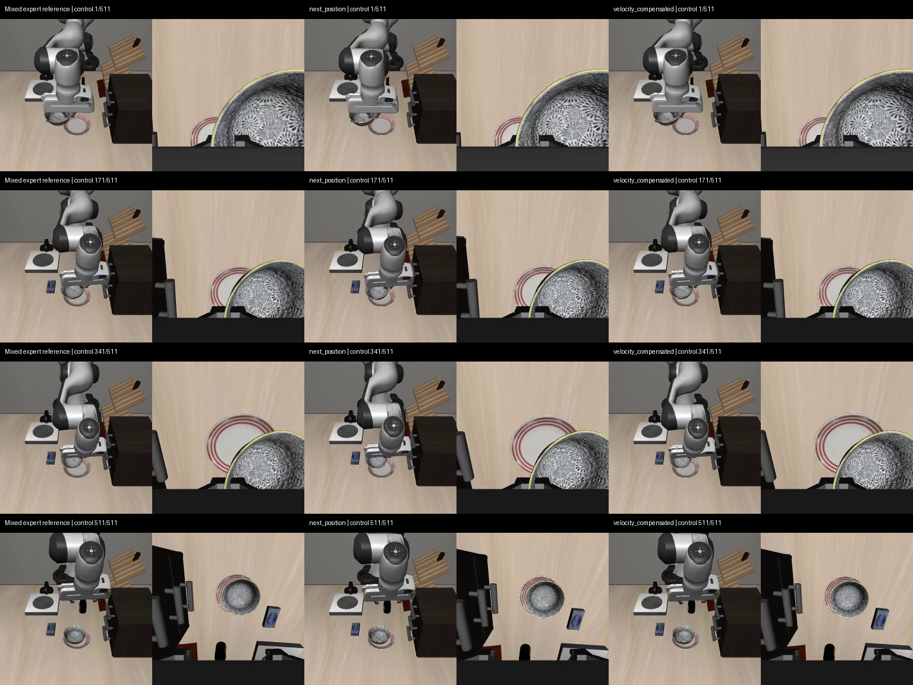
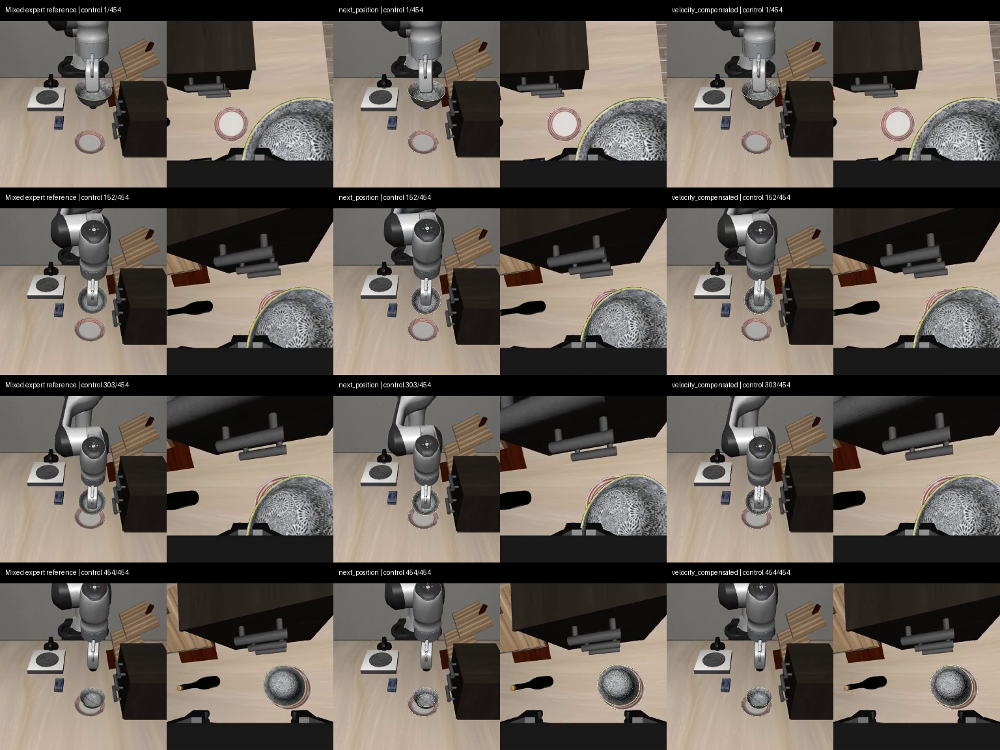

# 整臂关节动作契约验证（2026-10-29）

本轮只验证动作表示，不进行模型训练，也不替换中文面板中的策略。使用既有两条已人工审核示范的**新参考执行**与完整快照，不宣称恢复了旧录制的全部隐藏状态。

## 为什么要验证

现用训练输入为8维末端姿态/夹爪状态，动作是7维OSC（末端平移3、旋转3、夹爪1）。相同末端姿态可能对应不同肘部姿态，单纯补保存末端轨迹仍可能丢失人工调肘的信息。前轮已经补齐关节、末端和控制类型的采集，本轮测试另一种明确接口：7个关节绝对目标角（弧度）＋夹爪1，共8维动作；同时记录7个关节角＋两侧夹爪位置，共9维状态。

记录到的实际关节位置不是原控制器命令。JOINT_POSITION 的简化PD项为 `kp*(q_goal-q)-kd*qvel`，仅令目标等于下一帧实测角度可能滞后；因此预先固定两个候选，不根据结果反复调参：

- `next_position`：下一控制步参考实际关节角。
- `velocity_compensated`：下一控制步参考角＋`kd/kp * 参考关节角速度`，超出关节范围时限幅并记录。

两者均是使用专家未来参考的诊断跟踪器，不是学会自主恢复的模型，也不是原始人工命令。速度补偿并未补偿全部加速度、接触和模型误差。

## 固定边界与检查

两条来源 `human_1793121358375746008`、`human_1793122696228231033`，分别从原时间线73、223开始，执行491、434控制步，再各保持20步；20Hz，`kp=150`、`kd=2*sqrt(150)`。每个来源/表示在新进程创建仿真，共4次执行。完整初态恢复之后验证原OSC运行时/模型身份；切换为绝对关节控制器前后要求物理状态精确不变。执行中不注入参考qpos、不重置物体、不关闭接触；每一步确认实际控制器目标未被归一化缩放或悄悄裁剪，仿真时间增量为0.05秒。

门限沿用之前的物理转换检查：运动段末端位置P95≤2cm、姿态P95≤0.15rad，柜体最大穿透不得超过参考1mm；参考存在抓取则候选也需观察到抓取；最后连续20控制步原生目标成立且无手指接触。关节误差和限幅另外报告。柜体穿透及抓取标志只是测量代理，不证明全局无碰撞或力闭合。跟踪达标也不能证明泛化。

冻结输入见 [v2/protocol.json](v2/protocol.json)，实际仿真环境见 [环境记录](../../evidence/joint-contract29-environment.json)。协议包含运行脚本及快照/参考文件SHA256，执行前后校验。

## 已遇到的问题

首次v1在保存身份信息时调用了只支持OSC的旧快照身份函数，执行第一条物理动作之前退出。保留v1协议，没有把基础设施错误计作动作失败；修正为先验证并保存恢复时的OSC身份，另外记录新关节控制器身份，未改动冻结快照实现。完整实验重新放在v2。

独立审查代理因本机安装角色指定的gpt-5.5不受当前账户支持而未启动；本轮由主代理直接复核并执行测试，不声称有独立代码审查通过。

## 复现

在仓库根目录运行，输出目录必须不存在：

```bash
MUJOCO_GL=osmesa PYOPENGL_PLATFORM=osmesa OPENBLAS_NUM_THREADS=1 OMP_NUM_THREADS=4 \
.venv-ppo/bin/python -u scripts/verify_joint_actions.py \
  --output reports/joint-contract-reproduction/v1

.venv-ppo/bin/python scripts/render_joint_comparison.py \
  reports/joint-contract-reproduction/v1
```

依赖既有本机原始示范、完整快照与参考轨迹。脚本会验证来源哈希，不具备这些输入时不能仅靠代码复现实验。原始人工录制、权重没有在本轮重新上传。

## 四次实际执行结果

| 示范 | 表示 | 位置P95（mm） | 姿态P95（rad） | 关节最大误差的P95（rad） | 限幅控制步 | 放下后保持 | 完整门限 |
| --- | --- | ---: | ---: | ---: | ---: | --- | --- |
| A | next_position | 20.495 | 0.014029 | 0.030224 | 8 | 20/20 | 未通过 |
| A | velocity_compensated | 2.500 | 0.002042 | 0.003790 | 12 | 20/20 | 通过 |
| B | next_position | 18.047 | 0.014035 | 0.031723 | 0 | 20/20 | 通过 |
| B | velocity_compensated | 2.829 | 0.001850 | 0.004641 | 0 | 20/20 | 通过 |

四次执行都在最后连续20控制步达到原生放置目标且没有手指接触；直接角度版本1/2通过完整跟踪门，速度补偿版本2/2通过。控制器安装未改变物理状态、每步绝对目标精确匹配、仿真时间步及冻结输入检查均通过。共1930个真实控制步；两条人工轨迹的444/372个原关节控制步没有被丢弃。

这支持“整臂关节动作能够表达这两条人工示范”的有限结论。不能推成恢复泛化率，也不能把新关节控制器的跟随滞后当作现用OSC模型慢动作的已证实根因。此前12个开发场景微调未改善的问题仍未由本轮解决。

## 同步画面

每列内部左为外部相机、右为腕部相机；三列依次为混合控制专家参考、直接关节角、速度补偿关节角。严格按相同控制序号对齐（候选录像包含初态，制作比较时去掉该初态帧），20fps播放，无时间加速。原录像、逐步状态/动作和判定均保留在v2各来源目录。

- [human_1793121358375746008 三列同步视频](v2/human_1793121358375746008/comparison.mp4)



- [human_1793122696228231033 三列同步视频](v2/human_1793122696228231033/comparison.mp4)



## 接入训练前还需要什么

无需因为本轮诊断要求用户重新手动录这两条示范。已有原数据和完整参考继续保留。下一步应按通过验证的**同一关节控制接口**实际执行专家目标，重新保存动作前两路RGB、关节状态及实际下发的8维动作，再冻结训练数据/抽样方案。

现有公开回放主要提供7维OSC动作，不能把它的数字原样混成8维关节目标。关节训练需要匹配的状态适配、动作表示和归一化统计，并为公开回放选择有真实关节监督的数据或明确的分支方案。基础视觉语言模型可以延续，但不能仅改维度数字就宣称训练接口已接通。训练后仍需在固定开发初态上由模型闭环执行对照，单看专家跟踪成功不足以晋升模型。

本轮 `training_ready=false`，没有新的模型权重、没有替换现用面板、没有重跑训练或触碰封存测试集。代码/诊断产物的备份范围不包括本机原始人工录制和优化器检查点。

## 验证记录

27项针对性测试通过；新代码Ruff与编译通过。四次物理执行已正常退出。视频与轨迹完整性结果见 [artifact-validation.json](v2/artifact-validation.json)，运行日志见 [run.log](run.log)。实际画面另经查看，最终碗位于盘上且夹爪离开。远端备份证明单独记录，未通过推送输出来代替恢复验收。
