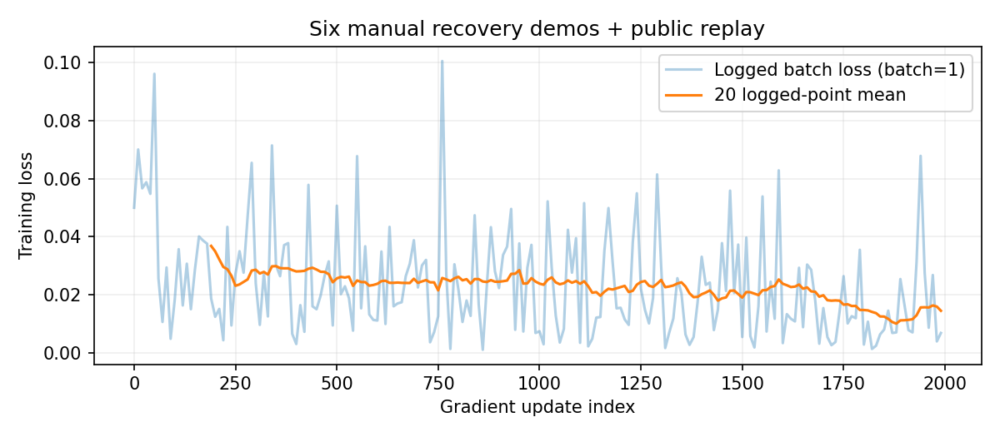
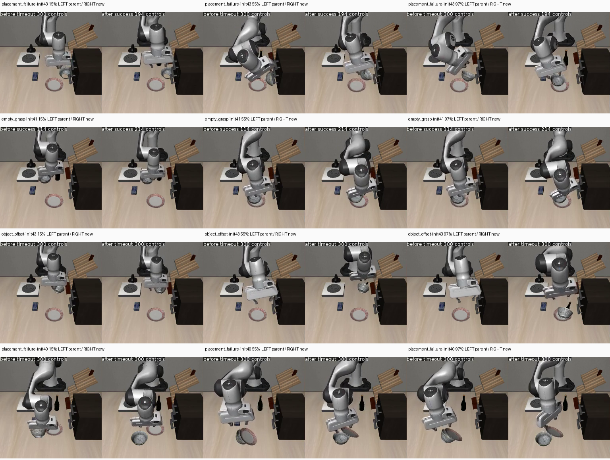

# 六段人工恢复示范：训练与配对仿真

实验 `manual6_replay2000_v1`。这轮不再要求仅换位置反复录制；检验已有示范在新失败初态的恢复效果，不承诺六条数据覆盖任意家庭场景。完成2000次更新及64次配对仿真。新失败初态5/12→6/12，旧失败初态9/12→9/12，常规8/8→8/8；仅有局部改善，动作效率未改善。

## 数据与动作边界

六条原始人工示范全部保留。四条纯OSC控制、两条混合OSC/关节接管。1630个真实OSC控制帧分成八个连续片段，1612个可作10步预测窗口起点；两个非终末片段的最后九个起点不采样，防止跨越关节接管。816个关节控制帧单独存档，不伪装为7维末端动作标签。

保持原20Hz动作，不以加速视频代替动作标签，不放大动作。图像与状态为动作前观测。关节接管修改过的nullspace目标不是当前策略输入，因此本轮不能声称学会整段关节绕障。

录制内部物理状态逐帧衔接、动作与原记录一致。一次独立纯OSC重放在手指接触附近发生数值偏差，终态仍成功；不能把内部衔接验证说成全部轨迹独立物理重放通过。

## 训练

从原40任务父模型 `multitask40_lora_v1/9999` 微调，不续训已退化候选。π0.5 LoRA，batch1、2000更新、seed42、lr5e-6、20步预热、新AdamW、无EMA。25%人工纠错、75%旧40任务回放，公共训练1525条；比例是采样槽位，实际读取计数包含预取。

OpenPI固定 `15a9616a00943ada6c20a0f158e3adb39df2ccac`。训练前全量校验公共训练/人工/父模型文件哈希及归一化；两分支官方transform动作均为(10,32)。配置和身份见[预先冻结方案](../../evidence/manual28-evaluation-plan.json)与[训练状态](../../evidence/manual6_replay2000_v1-status.json)。实际完成2000更新，训练循环320.73秒（不含数据/父模型校验），采样含预取为人工543、回放1458；峰值采样内存29.96GiB，正常退出0，无OOM。完整检查点1999留在本机。



图中loss来自batch1训练窗口，不是成功率，也不作为泛化证明。

## 评测

训练前冻结新开发源ID40..43×抓空/物体偏移/放置失败=12例；旧开发20..23另12例回归；常规任务0/7/8/9各init0/10共8例保持。原留出10..13继续隔离。新开发属于开发评测，不称盲测。

两模型均用原生JAX策略服务、相同初态和代码、每例重置噪声seed42，预测10步执行前5步。每例上限300控制步；碗放盘子要求原生目标成立且无手指接触连续5步。视频是模型的真实控制，没有脚本恢复替代。

晋级门槛：新开发总成功数严格提高且各类别不下降，旧开发总数和各类别不下降，保持8/8。不自动替换面板。

低运动诊断：末端位移小于0.2mm/控制步，统计连续长度、占比、总控制步及墙钟时长；排除原生目标已成立的末段。有意夹持和接触保持也可能被计入，不单凭该数值断言卡死。

## 结果

| 同初态配对项目 | 40任务父模型 | 六段人工恢复微调后 |
|---|---:|---:|
| 新开发：抓空 | 2/4 | 2/4 |
| 新开发：物体偏移 | 2/4 | 2/4 |
| 新开发：放置失败 | 1/4 | 2/4 |
| 新开发合计 | 5/12 | 6/12 |
| 旧开发：抓空/偏移/放置 | 4/4、4/4、1/4 | 4/4、4/4、1/4 |
| 旧开发合计 | 9/12 | 9/12 |
| 常规四任务、双初态 | 8/8 | 8/8 |

本轮达到预先冻结的候选晋级门槛，但只多成功1例，不足以声称显著提升或通用恢复。面板模型未替换。仍有6/12个新失败初态超时，训练交付完成不等于恢复问题解决。本轮是LoRA模仿学习，没有新做PPO更新，没有固定动作脚本代替模型恢复。

唯一改变成功与否的是 `dev-placement_failure-init43`：父模型300步超时，新模型194步达到连续松爪条件。[左右同步对比视频](../../artifacts/20261028-manual6/fresh-comparison/comparison-dev-placement_failure-init43.mp4)。

全部64次原录像与24次左右对比共88个视频完整解码通过，成功和失败均保留。[新开发完整对照](../../artifacts/20261028-manual6/fresh-comparison/comparison.json)、[旧开发完整对照](../../artifacts/20261028-manual6/regression-comparison/comparison.json)、[机器可读总验收](../../evidence/manual28-final-evaluation.json)。同步比较左父模型、右新模型，同控制时钟20fps；较早结束的一侧冻结最后画面。常规保持录像沿用旧记录器10fps，实际物理控制20Hz，因此播放比仿真慢2倍，不能用它估计动作速度。



图第一行为唯一新增成功，第二行为双方成功但新模型更慢，第三、四行为仍然失败。末帧可见部分场景碗倾斜、偏离盘子；只凭画面不能断言接触力或奇点。

## 训练前速度诊断

各人工片段平移命令幅度有0.1和0.6两档，并非所有动作都设置得很小；部分片段31%–59%帧无平移，但其中包含旋转、夹持或释放，不能一概删除。原动作未放大。[人工动作统计](../../evidence/manual28-human-action-diagnostics.json)。

## 训练后速度与失败边界

双方都成功的相同案例才用于效率比较：新开发5对的中位步数89→116，旧开发9对90→110。常规8对中位107.5→114.5。当前候选没有提速，不能因多成功一例而忽略变慢。

新开发低于0.2mm/控制步、且原生目标未成立的总控制步占比为67/2588→37/2707；最长连续5→7步（0.25→0.35秒仿真时间）。旧开发最长1→5步。这轮未重现数分钟静止，但“低运动占比下降”和“完成总步数增加”并不矛盾：重复寻找、错误方向和绕行也会拖慢完成。

失败最后50步，新模型仍输出0.217–0.565的平移命令范数，实际末端中位运动1.587–7.277mm/步。父模型偏移init43命令范数0.815、实际0.252mm/步；说明“动作数值不小但执行受限”在本轮确实存在，碰撞/约束是待查因素，并未通过接触力和关节雅可比证实。不能把全部问题归因于录制步幅、过拟合或训练次数。[失败尾段诊断](../../evidence/manual28-failed-motion.json)。

300步上限等于15秒物理控制预算；6个新失败均因到达预算停止，此时未达到原生目标。这里证明的是“预算内失败”，不能证明延长到任意时间都无法完成。墙钟中位7.60→7.32秒混合了首轮JIT、渲染、策略和控制步数，不作为机械动作提速结论。

## 之后怎么做

先不再要求仅换坐标录更多条。保留当前候选和原父模型，先针对剩余失败做分阶段定位：确认是碗未抓稳、反复对齐、碰撞受限还是已到位未松爪；分别看命令、真实末端运动、物体运动与接触。若是控制器受限，先修控制/姿态契约；若是策略反复错误动作，再做少量针对失败决策的有效示范或恢复初态RL，不靠堆训练步数碰运气。

两段混合示范的关节绕障目前只归档，不进入OSC策略梯度；若目标是学会中间关节绕障，需要把关节/姿态条件与策略输出契约配套，而不是把关节动作硬转成末端7维标签。六条示范并不能覆盖任意物体、指令或家庭；这里仅检验同一碗放盘子任务的新失败状态。

## 复现

在已准备好的本机环境中运行；选择新实验名避免覆盖。原40任务训练集、官方基座和原父模型需存在，公共数据路径/文件哈希由训练状态固定。原始人工数据和评测初态通过下方Release恢复，不能把评测初态当训练数据。

```bash
cd /home/robot/pi05-rl-handson
python3 - <<'PYPLAN'
import json
from pathlib import Path
plan = json.loads(Path('evidence/manual28-evaluation-plan.json').read_text())
plan['experiment'] = 'manual6_replay2000_reproduce'
Path('.local/manual6-reproduce-plan.json').write_text(json.dumps(plan, indent=2))
PYPLAN
XLA_PYTHON_CLIENT_PREALLOCATE=false .venv-train/bin/python scripts/train_recovery_replay.py \
  --experiment manual6_replay2000_reproduce --steps 2000 --learning-rate 5e-6 \
  --recovery-manifest evidence/manual-recovery28-manifest.json \
  --evaluation-plan .local/manual6-reproduce-plan.json
```

终端一启动本轮权重；对照父模型时，仅将checkpoint改为 `checkpoints/pi05_multitask40_lora/multitask40_lora_v1/9999`。`--parent`表示官方基座，不是本报告的40任务父模型，勿混用。

```bash
XLA_PYTHON_CLIENT_PREALLOCATE=false .venv-train/bin/python scripts/serve_sft.py \
  --checkpoint checkpoints/pi05_recovery_replay_lora/manual6_replay2000_v1/1999 --port 9875
```

终端二执行本轮新开发场景。输出目录需为空；不覆盖旧结果。

```bash
PYTHONPATH=/home/robot/voice-arm-sim/.local/openpi/third_party/libero \
MUJOCO_GL=egl PYOPENGL_PLATFORM=egl CUDA_VISIBLE_DEVICES=0 \
TORCH_FORCE_NO_WEIGHTS_ONLY_LOAD=1 .venv-ppo/bin/python scripts/evaluate_recovery.py \
  --port 9875 \
  --expected-server-checkpoint "$PWD/checkpoints/pi05_recovery_replay_lora/manual6_replay2000_v1/1999" \
  --manifest data/recovery-bowl-freshdev28/manifest.json --split dev \
  --max-steps 300 --output evaluations/manual6_reproduce_new_fresh
```

## 验证与备份

项目CPU pytest 81项通过，另有80条既有Flax弃用警告。此次配对仿真由真实JAX服务执行；64条记录无执行异常、88段视频完整解码通过。没有真机验证，面板交互延迟也不由这轮离线评测覆盖。

公开备份：[代码分支与全部结果](https://github.com/sencangWei/pi05-rl-handson/tree/experiment/matched-recovery-20261027)、[数据与LoRA Release](https://github.com/sencangWei/pi05-rl-handson/releases/tag/manual6-recovery-20261028)。推理备份不含优化器；本机完整检查点含训练状态。

数据包 `manual6-data.tar.gz` 564035222字节，SHA256 `9f4a2754251209e9f1a7e086d172649e0323808aaf3e397fbb14b7714e6e7c26`。已独立匿名下载，检查Content-Range、完整长度及SHA，解压后4226文件逐一核对：[恢复证据](../../evidence/manual28-data-remote-restore.json)。

LoRA包 `manual6-adapter.tar.gz` 185497214字节，SHA256 `b86b40fba513536145799c1458059c09c69a42c3715ecc360b3235e8d85875e8`。本地从官方基座加20个LoRA重构全部71参数叶子一致，树SHA256 `5af8859ec2c857d46d44a663c73056a55270dab49561ed1877d96f99f3654932`。已从GitHub独立匿名下载，校验完整SHA并解压，再从官方基座重构全部71参数叶子一致：[远端权重恢复证据](../../evidence/manual28-adapter-remote-restore.json)。

代码与结果提交 `18e2041ad82a0198264d2dabba34e024e9fe1da4` 已从GitHub独立克隆拉取并检出，完整树对象一致、2615个跟踪文件内容逐一一致：[代码远端恢复证据](../../evidence/manual28-code-remote-restore.json)。
