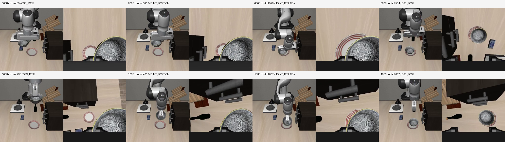

# 混合关节接管：原动作执行验证（2026-10-28）

两条已批准人工录制都能通过原 OSC→关节→OSC 控制完成放碗和释放；**严格轨迹保真均未通过，本轮没有生成 OSC 标签、没有训练，也没有替换面板模型**。这证明原操作有可执行价值，不代表模型已学会恢复。

## 实际执行结果

| 原录制尾号 | OSC／关节控制数 | 最终原生目标成立且无手指接触 | 严格轨迹保真 | 缓存位置最大坐标误差 |
|---|---:|---:|---|---:|
| 6008 | 120／444，共564步 | 连续33步，1.65秒 | 未通过 | 31.28mm |
| 1033 | 285／372，共657步 | 连续44步，2.20秒 | 未通过 | 19.66mm |

以上为补齐原始初始化刷新流程后的 `original-v2`。步数是实际20Hz控制数，非训练更新数；录像20fps，每步一帧，无额外初始帧。释放检查要求末尾至少连续5步原生目标成立且没有任意手指碰撞面接触；它不是大规模恢复成功率。

- 6008：[执行录像](original-v2/human_1793121358375746008/executed.mp4)、[逐步指标](original-v2/human_1793121358375746008/steps.json)、[实际物理状态](original-v2/human_1793121358375746008/executed-states.npz)。
- 1033：[执行录像](original-v2/human_1793122696228231033/executed.mp4)、[逐步指标](original-v2/human_1793122696228231033/steps.json)、[实际物理状态](original-v2/human_1793122696228231033/executed-states.npz)。
- [诊断汇总](diagnostic-summary.json)、[两次运行四段录像的全帧解码检查](video-validation.json)。总计2442帧，全部解码成功。

## 如何避免把状态播放冒充动作执行

输入为两条原录制，身份对照 [冻结清单](../../evidence/manual-recovery28-manifest.json) 逐文件 SHA256 核验；结束后再核验，原数据未修改。初态仅加载一次，随后每步刷新只使用**执行产生的当前状态**。没有注入录制的后继状态，没有关掉碰撞或直接写目标位置。

OSC 使用物理档案中的 float64 原动作，而非训练帧内 float32 副本。关节接管使用原绝对七关节目标及夹爪动作；每12步重建原 JOINT_POSITION 控制器，并恢复原 OSC 对象、更新零空间锚点和目标。68次关节jog的边界完整保留。预检覆盖1221个连续控制。

原关节实现 SHA256 `93e74726d2ddc6b50fe368e14893eccced098294c2970d84134153d1c55b5b7f` 与录制元数据一致。运行时为 MuJoCo3.8.1、robosuite1.4.1、NumPy1.26.4、seed42、20Hz、物理子步2ms。模型 `nq=41, nv=37`，79值快照由time、qpos、qvel组成；[运行时源码身份与状态接口](runtime-contract.json)。

## 严格检查哪里失败

运行前固定最大坐标误差门：qpos `1e-6`、qvel `1e-5`、缓存末端／碗位置 `1e-5m`。qpos、qvel包含平移和转动坐标，不能把整个数组最大值都解释成米或弧度。没有在看完结果后放宽门。

两条均在第一个控制步超门，但机器人七关节和夹爪qpos在该步与原记录完全相同，控制前后仿真时间也相同。首步全qpos最大差 `1.01418e-5`、qvel差 `2.25866e-4` 来自非机器人对象部分，后续接触中差异放大。v2全程最大qpos坐标差约0.1101／0.1067，qvel差约5.7943／4.4797；目标布尔值与原记录分别有1／0步不一致。虽然最终释放门通过，也不能声称精确复现。

从Git历史找到了与录制元数据完全同SHA的启动器：提交 `7b2f7a9e49c1a29adb88632b6966f1634235c700` 的 `scripts/manual_recovery.py`，SHA256 `1233f81994d3ed3f533090295312caa7a53ef34aa2149a64d87f28111049b00b`。当时零偏移场景编辑和开始接管都会额外刷新状态。v1遗漏了这两次刷新；v2补齐后，首步缓存末端差由约0.512／0.518mm降至0.169／0.171mm，但**两次执行的time/qpos/qvel数组逐位相同**。说明这两次刷新影响观测时序，未消除动力学偏差。v1结果及两版执行源码快照均保留，各源码SHA与对应protocol一致。

已确认的限制：旧快照接口只保存time/qpos/qvel，没有完整求解器状态、控制器内部目标和观测采样时序。求解器热启动、未存内部状态、原查看器同步等仍是待隔离因素；本轮**没有证明哪个是唯一误差源**，也没有证据把偏差归咎于人工操作质量或训练次数。

## 对训练的影响和下一步

[上轮审计](../recovery-events-20261028/README.md) 已证明，两条录制的关键关节搬运没有进入当前7维OSC训练标签。本轮进一步证明原搬运能执行；但由于原动作严格保真门失败，按事先约定，**关节→OSC转换阶段未启动**，没有生成位姿差分伪标签，也没有用更多训练步掩盖控制契约缺口。

下一步优先在独立实验中补全仿真积分状态、控制器目标／零空间锚点、夹爪累计量和观测时序的保存恢复，用短的含接触混合操作验证精确复演。旧录制无法凭空补回未存状态，完整保留作参考，不要求重录所有位置。保真门通过后，再实际执行验证7维末端控制能否完成搬运；若必须控制中间关节姿态，则需要显式的状态／动作契约适配。任何转换与重训都需独立执行验证，不能将人工关节回放称作模型恢复。

## 交付验证

- 新增重放器和4个控制边界拒绝测试；本轮运行30个相关测试通过，错误级Ruff通过。
- 四段双相机录像全部解码；原始元数据和文件SHA再次核验不变。原始数据的远端归档沿用[已核验的六示范备份](../recovery-taskphase-20261028/README.md)。
- 当前面板、模型和其他运行任务未修改；无真机操作、无新梯度更新、无封存集评测。剩余风险是严格状态恢复未解决，现有模型恢复问题仍存在。
- [复现命令](commands.md)。源码、测试和本目录证据已提交 `5048f3eadc93a8e1b829e5184dd35be8eabf2a74` 至用户自有 `sencangWei/pi05-rl-handson` 的 `experiment/matched-recovery-20261027` 分支。从远端内容独立恢复全部3307个跟踪文件，逐文件SHA256一致，重建Git树 `f36ef5616a70b282946c958c3944a7c277e939e4` 一致；[恢复验证证明](../../evidence/mixed-replay-28-remote-restore.json)。
