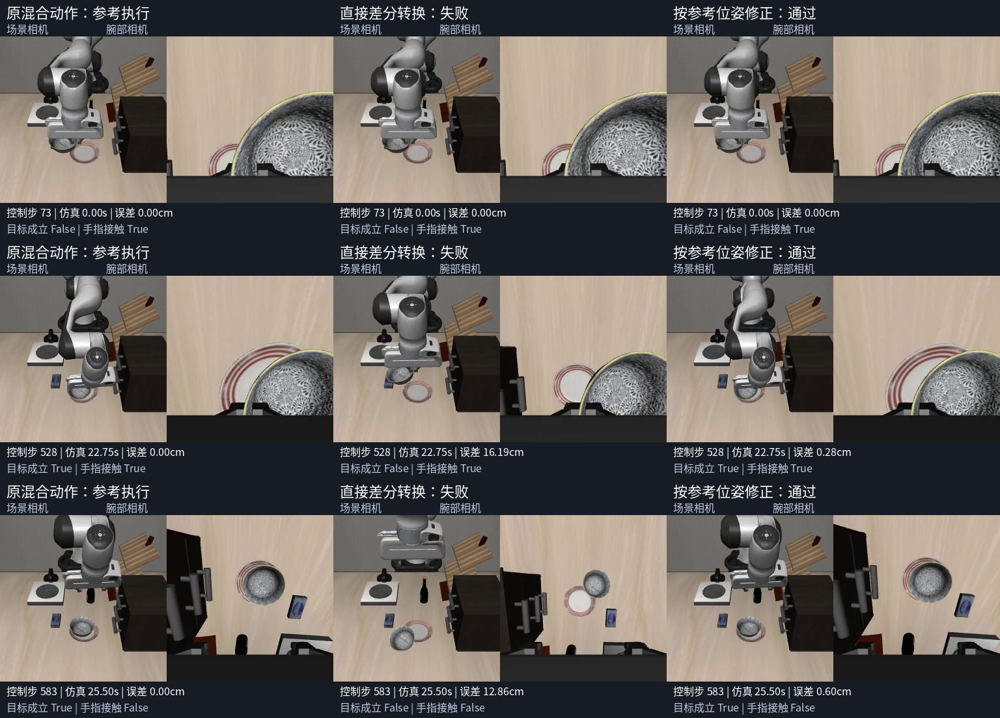
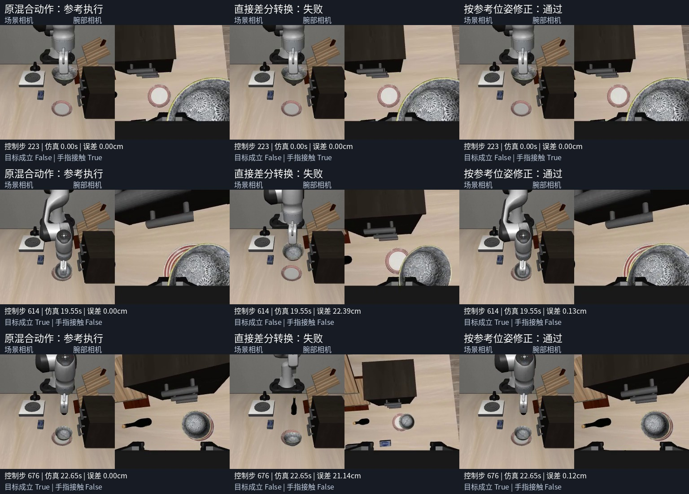

# 人工关节恢复 → 7维OSC：转换与物理重放

2026-10-29。批准范围是两段恢复动作的可执行性实验；本轮没有训练、没有替换面板模型。

**结果：直接用参考轨迹相邻帧的位姿差作OSC动作，0/2通过；用参考下一位姿与当前实际位姿之差作动作，2/2通过。** 后者是使用专家参考轨迹的控制转换，不是π0.5自主恢复。它只证明这两段新参考的恢复效果能通过现有7维接口执行，不能证明位置泛化或恢复成功率。

## 配对结果

每个模式从同一完整快照开始，独立新进程执行。参考执行保留人工原OSC与关节动作的切换；两个候选仅替换关节段，原OSC动作与夹爪指令不变。未注入参考下一物理状态，也未用关节目标更新候选OSC的零空间锚点。

| 源录制后缀 / 起点 | 方式 | 位置误差P95 | 朝向误差P95 | 末尾20步放置且手指无接触 | 总门槛 |
| --- | --- | ---: | ---: | --- | --- |
| 6008 / 73 | 原混合动作参考 | 0 | 0 | 20/20 | 通过 |
| 6008 / 73 | 相邻参考位姿直接差分 | 15.72 cm | 0.2861 rad | 0/20 | 失败 |
| 6008 / 73 | 参考下一位姿－实际位姿 | 1.20 cm | 0.0215 rad | 20/20 | 通过 |
| 1033 / 223 | 原混合动作参考 | 0 | 0 | 20/20 | 通过 |
| 1033 / 223 | 相邻参考位姿直接差分 | 22.27 cm | 0.4491 rad | 0/20 | 失败 |
| 1033 / 223 | 参考下一位姿－实际位姿 | 0.85 cm | 0.0317 rad | 20/20 | 通过 |

两个参考的剩余491/434控制与此前完整状态实验的新参考逐个物理状态**位级一致**，再各执行20步释放保持。每步0.05秒、25个物理子步，共2895次控制、72375个物理子步。候选转换444/372个关节控制，合计816；没有动作饱和。`reference`结果中`converted_joint_controls`表示待转换的关节控制数量，参考本身仍执行原关节控制。

直接差分分别在原控制编号89、250首次超过2厘米位置误差，两段始终没有达到原生放置目标。按实际位姿修正的两段全程位置误差未超过2厘米，原生目标分别在522、612首次成立。最终20步均目标成立、无手指接触；稳定检查仅为1秒，不是长期稳定性试验。

所有模式均观察到抓取代理成立；这不证明力闭合或从任意抓空状态恢复。柜体接触逐物理子步记录：6008参考峰值穿透0.312毫米、修正转换0.065毫米；1033两者为0。该指标只检查机器人/夹爪与名称包含cabinet的几何体，不能当作全场景无碰撞证明。

## 查看实际录像

三栏从左至右：原混合动作参考、直接差分失败、按参考位姿修正。每栏含场景相机和腕部相机，保持20fps、没有加速，三栏按相同控制编号同步。

- [6008 同步对照视频](v1/human_1793121358375746008/comparison.mp4) · [关键帧](v1/human_1793121358375746008/contact-sheet.jpg)
- [1033 同步对照视频](v1/human_1793122696228231033/comparison.mp4) · [关键帧](v1/human_1793122696228231033/contact-sheet.jpg)





保留六段原视频、两段对照视频、逐步动作/状态/误差/接触和两组候选动作；八视频共3860帧完整解码通过，见[视频核验](v1/video-validation.json)。候选NPZ是诊断动作，并未作为训练集发布。

## 为什么直接差分失败

OSC输入是控制器目标增量，不是承诺在一个控制周期内实际到达的位移。直接把专家相邻帧的实际位移当作下一目标增量，没有补偿当前执行与参考轨迹之间的偏差，本实验发生了累计跟踪偏离。姿态控制还存在旧目标保持与零空间锚点等内部状态；7维末端指令也没有单独控制肘部构型的通道。

修正转换在每个关节控制时刻使用 `target_position[t+1] - actual_position[t]`；朝向用世界系左乘约定 `log(R_target[t+1] @ R_actual[t].T)`。再按实际OSC的输入/输出范围反缩放，保留原夹爪动作。实际位姿在独立MjData副本上做正运动学读取，避免刷新执行环境的物理/观测缓存。原OSC控制时刻仍原样执行，不额外追踪参考。

结果支持“直接改数组标签不够，必须物理验证”的结论，也表明**这两段动作并没有被现有接口完全封死**。不能由此断言此前模型停滞全部由关节段缺失造成，也不能说所有肘部避障都能转换成功。

## 冻结的验收与身份

[protocol.json](v1/protocol.json)在首个物理进程前写入：seed42；P95位置≤2厘米、P95朝向≤0.15弧度；柜体峰值穿透不超过参考+1毫米；出现抓取代理；末尾20控制全部原生目标成立且无手指接触。未放宽门槛或延长某一候选预算。

完整源名为`human_1793121358375746008`、`human_1793122696228231033`；原录制哈希来自[evidence/manual-recovery28-manifest.json](../../evidence/manual-recovery28-manifest.json)，本轮各进程再次校验。快照来自[完整状态实验](../full-state-replay-20261028/README.md)。旧录制没有保存的内部状态仍不可补回；本实验转换的是从旧指令新执行生成且可复现的参考，不能称为原录制逐帧恢复。

运行环境为`.venv-ppo`、Python3.11.15、MuJoCo3.8.1、robosuite1.4.1；[环境证据](../../evidence/osc-conversion29-environment.json)、[汇总](v1/summary.json)、[校验证据](../../evidence/osc-conversion29-validation.json)记录源码身份与结果。重放入口及四个依赖源码的SHA已冻结在协议中。

## 复现

在项目根目录执行；输出使用新目录，程序拒绝覆盖已有物理实验。

```bash
rtk proxy env \
  PYTHONPATH=/home/robot/voice-arm-sim/.local/openpi/third_party/libero \
  MUJOCO_GL=egl PYOPENGL_PLATFORM=egl CUDA_VISIBLE_DEVICES=0 \
  OMP_NUM_THREADS=2 OPENBLAS_NUM_THREADS=2 TORCH_FORCE_NO_WEIGHTS_ONLY_LOAD=1 \
  .venv-ppo/bin/python -u scripts/verify_osc_conversion.py \
  --output reports/osc-conversion-20261029/reproduction

rtk proxy .venv-ppo/bin/python scripts/render_osc_conversion.py \
  reports/osc-conversion-20261029/reproduction

rtk proxy .venv-ppo/bin/python -m pytest -q \
  tests/test_osc_action_conversion.py tests/test_simulation_snapshot.py \
  tests/test_mixed_correction_replay.py tests/test_manual_joint_control.py
```

30项针对性测试、四文件Ruff、三脚本编译通过。渲染脚本初次遇到imageio Reader不是iterator的问题，改用`iter(reader)`后完成；此问题未改动任何物理执行结果或协议。

## 后续训练应如何接

下一阶段应从通过的物理转换重新采集**实际执行前RGB/状态与对应7维动作**，审核画面、阶段和原始示范的关联，明确标注为“由人工指令产生的新参考，经专家轨迹转换”。不能把转换后的动作直接配上旧录制或参考轨迹的RGB/状态，因为执行轨迹已有差别。保持连续20Hz，不把视频快放当作动作重标注。

形成可训练样本后，再固定父模型、旧数据回放比例和留出恢复场景做有界微调。对比的是学习后自主策略，而不是本轮使用专家未来参考位姿的转换器。两段不能证明恢复覆盖充分；本轮没有训练，也没有改动现役模型。

## 远端备份核验

代码、配置、报告和实际录像已随载荷`9eec59001dd9bd6daa69779332566ce3d5317611`推送至自有公开仓库[sencangWei/pi05-rl-handson](https://github.com/sencangWei/pi05-rl-handson/tree/experiment/matched-recovery-20261027)。从远端独立恢复全部3461个跟踪文件，逐文件内容及重建Git树`84671b2b0123f9874ac1a553d20d22d11768b4be`完全一致；恢复代码的9项转换测试通过。[恢复证明](../../evidence/osc-conversion29-remote-restore.json)。本轮没有新模型权重或训练集。
