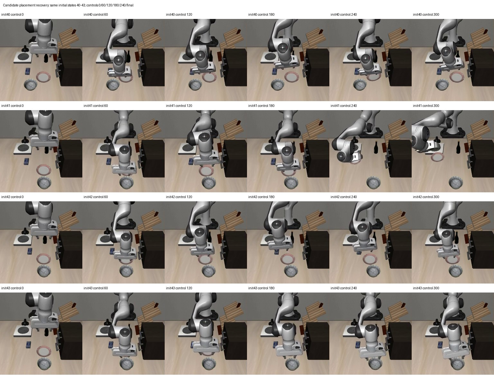

# 已审核OSC恢复示范补充微调

状态：2000次更新与父模型/候选各12例仿真评测已完成。

沿用40任务父模型，保留全部旧人工纠错和公开回放；新增两段用户确认的专家执行监督。专家示范成功不等于模型恢复成功。

2000次更新、batch1、seed42、lr5e-6、fresh AdamW、LoRA；75%公开/25%合并恢复槽，20Hz动作标签不变。新增示范排除末尾诊断保持和不足完整10步窗口的起点。

按相同协议重新评测父模型和候选模型的12个已有开发场景：抓空、偏移、放置失败各4个，最多300控制步，预测10步执行5步。原生放置成功且无夹爪接触连续5步才算成功。全部失败保留在分母中。封存集不打开，本轮不自动替换面板，普通40任务技能回归另行验证。

## 实际结果

| 模型 | 成功/12 | 抓空/4 | 偏移/4 | 放置失败/4 | 总控制步（含超时） |
|---|---:|---:|---:|---:|---:|
| 人工纠错前40任务父模型 | 9/12 | 4/4 | 4/4 | 1/4 | 1839 |
| 本轮专家补充微调模型 | 6/12 | 2/4 | 4/4 | 0/4 | 2821 |

共同成功6例，控制步中位数92.5→166.5；逐场差值中位数63.0。
预先冻结门槛：{"success_at_least_10_of_12": false, "paired_controls_median_no_worse_than_parent": false}。

全部失败、超时保留在分母。每次最多300步=15秒仿真时间，墙钟时长分别记录，不等同于交互面板响应延迟。
本轮未评测封存集、普通40任务旧技能；未替换面板。12例是重复使用的开发集，不能宣称未知场景泛化。

## 训练证据

实际梯度样本来源：{"human": 543, "replay": 1457}。
2000个梯度样本与冻结种子预览逐项相同；额外预取不计训练。200条已记录loss/梯度/参数范数均有限。
人工原数据全部保留。两段新增监督来自人类恢复轨迹的专家OSC执行，不能当作模型自己完成任务。
本轮为监督LoRA微调，无新增PPO。新增监督与抽样分布共同变化，不能声称单一因素的因果改善。

## 同场景左右录像

左=父模型，右=本轮模型，20Hz原仿真时间；先结束的一侧冻结末帧。

| 场景 | 父模型 | 本轮 | 最长低运动步（父/新） | 同步录像 |
|---|---|---|---|---|
| dev-empty_grasp-init40 | 成功 90步 | 超时 300步 | 0/14 | [录像](../../artifacts/20261029-osc-sft/parent-comparison/comparison-dev-empty_grasp-init40.mp4) |
| dev-object_offset-init40 | 成功 129步 | 成功 224步 | 0/0 | [录像](../../artifacts/20261029-osc-sft/parent-comparison/comparison-dev-object_offset-init40.mp4) |
| dev-placement_failure-init40 | 超时 300步 | 超时 300步 | 1/1 | [录像](../../artifacts/20261029-osc-sft/parent-comparison/comparison-dev-placement_failure-init40.mp4) |
| dev-empty_grasp-init41 | 成功 97步 | 成功 125步 | 0/0 | [录像](../../artifacts/20261029-osc-sft/parent-comparison/comparison-dev-empty_grasp-init41.mp4) |
| dev-object_offset-init41 | 成功 89步 | 成功 244步 | 0/0 | [录像](../../artifacts/20261029-osc-sft/parent-comparison/comparison-dev-object_offset-init41.mp4) |
| dev-placement_failure-init41 | 超时 300步 | 超时 300步 | 3/1 | [录像](../../artifacts/20261029-osc-sft/parent-comparison/comparison-dev-placement_failure-init41.mp4) |
| dev-empty_grasp-init42 | 成功 74步 | 成功 105步 | 0/0 | [录像](../../artifacts/20261029-osc-sft/parent-comparison/comparison-dev-empty_grasp-init42.mp4) |
| dev-object_offset-init42 | 成功 96步 | 成功 115步 | 0/0 | [录像](../../artifacts/20261029-osc-sft/parent-comparison/comparison-dev-object_offset-init42.mp4) |
| dev-placement_failure-init42 | 超时 300步 | 超时 300步 | 0/3 | [录像](../../artifacts/20261029-osc-sft/parent-comparison/comparison-dev-placement_failure-init42.mp4) |
| dev-empty_grasp-init43 | 成功 96步 | 超时 300步 | 0/14 | [录像](../../artifacts/20261029-osc-sft/parent-comparison/comparison-dev-empty_grasp-init43.mp4) |
| dev-object_offset-init43 | 成功 89步 | 成功 208步 | 0/0 | [录像](../../artifacts/20261029-osc-sft/parent-comparison/comparison-dev-object_offset-init43.mp4) |
| dev-placement_failure-init43 | 成功 179步 | 超时 300步 | 3/2 | [录像](../../artifacts/20261029-osc-sft/parent-comparison/comparison-dev-placement_failure-init43.mp4) |

低运动=末端单步位移小于0.2mm且未满足原生目标，只作停滞提示，不能单独证明原因。
复现命令见 commands.md；输入协议与校验见 evidence/osc-sft29-*；逐步轨迹和完整结果见 artifacts/20261029-osc-sft。

## 结论与失败画面

本轮两个预设门槛均未通过：成功9/12→6/12，共同成功6例的控制步中位数92.5→166.5，逐场增量中位数+63步。新增监督的可执行性通过不代表策略能学会恢复；本轮不晋升，不替换面板。

四个放置场景300步内均从未满足原生目标。init40/41/42没有任何夹爪接触，碗高度完全不变，机械臂在盘子附近动作；init43有56步夹爪接触，但未完成搬运。不是已经放好之后仅被“松手检查”拦截。记录见 evidence/osc-sft29-failure-analysis.json。

新增两条专家示范开始时已拿着碗，主要补搬运/放置；因此“拿到碗的阶段监督偏向，干扰未抓取阶段”值得核查，当前只是解释假设。不能仅凭这轮结果认定视频录错、步数不够或必须多录不同位置。下一项最小诊断应先从专家保存的完整初态执行父/新策略，区分同分布拟合失败与抓取到搬运的阶段切换失败，再决定监督配比或补充片段。尚未执行这项新实验。

本轮重新跑的父模型是9/12，此前记录为10/12；没有挑选旧的更好成绩替换本轮结果。单个训练种子、每初态一次回放不足以给出统计稳定性保证，重跑差异来源尚未隔离。

23项针对性测试与9项子测试、限定范围Ruff通过。60个视频文件（含复制，36个唯一视频）全解码通过，共12201帧（含复制）。端口切换曾因TIME-WAIT误报中断，已仅修启动检查并接续候选评测，原失败日志保留；训练源文件和策略执行协议未改变。

## 交付与备份范围

[数据及权重 Release](https://github.com/sencangWei/pi05-rl-handson/releases/tag/osc-expert-sft-20261029) 标为实验预发布，并明确记录负面结果。两份新增专家Parquet及训练清单已从远端重新下载，四个文件SHA256全部一致；证据为 evidence/osc-sft29-data-restore.json。原始人工数据没有删除。

推理适配器已从Release独立下载，压缩包及三个文件SHA256全部一致；使用官方pi05_libero基座重建的71个张量（含20个LoRA张量）与原模型精确一致。证明见 evidence/osc-sft29-adapter-restore.json，重建日志为 remote-adapter-verify.log。完整可续训的优化器检查点仅保存在本机，本Release不等同于完整续训备份。

源码、配置、逐步结果、失败录像和12段并列录像已提交至自有公开仓库 sencangWei/pi05-rl-handson 的 experiment/matched-recovery-20261027 分支。载荷提交 b2ed8691448d2b94e1e7589c148d481662efee90 的3644个跟踪文件已在独立目录从远端恢复，内容SHA256与重建Git树 bdd46e4ec5c46162a75de517e0470cea7e347f37 全部一致；证明见 evidence/osc-sft29-final-remote-restore.json。普通Git推送超时后改用GitHub Git数据API，上传前后blob/tree/commit身份一致，更新分支时未强推。不会把本轮模型接入面板。
