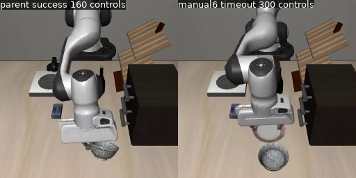

# 恢复失败与慢动作：分层诊断及测试场景修复

2026-10-28。本轮完成诊断、初态生成器修复和真实模型前后对照，**没有再次训练，也没有修好模型的全部恢复能力**。原人工录制、原评测、面板与模型权重均保留。

## 核心发现

1. **旧测试场景存在生成错误。** 恢复碗被直接移位后，旧生成器只检查位置稳定、夹爪接触和目标状态，没有排除碗与柜子、盘子、酒瓶穿插。旧12个开发初态中，6个未通过本轮碰撞穿透检查，成功案例也有污染。因此原报告的5/12→6/12不能继续作为可信的恢复提升结论；不能只删失败案例重新算成功率。
2. **有效场景仍有真实的策略问题。** 修正初态后，两个模型都完成10/12；没有整体成功率提升。共同成功的9个场景，微调模型全部需要更多控制步，中位数95→114步，增加20%。这支持微调后动作效率退化，尚不能仅凭这一组小样本区分过拟合、采样偏重或具体数据标签的因果作用。
3. **单纯延长步数不足以解决。** 对原六个失败案例从300延长到600控制步，仍0/6成功。其中五个初态本身无效；剩余有效的placement40仍失败，说明至少这一例不是只差少量运行预算。不能据此断言所有新场景600步必失败。
4. **“慢”的原因不止一种。** 无效场景能引发真实碰撞阻塞、力矩饱和及小平移雅可比奇异值；新有效场景的两个失败则全程未抓住碗，却继续在盘子附近运动。后者不是“已经拿着碗，只等松手”。这描述可观测行为，不推断模型内部认为自己拿到了什么。

## 实际改动

- `scripts/build_recovery_bank.py`：碗插入后、静置后均检查接触穿透；碗对桌面容许1mm软接触，对其他物体容许0.1mm数值接触。候选耗尽明确失败并保存拒绝原因。原四个等距角点全碰撞时，追加12个同半径角度，未放宽碰撞门，未按模型成功与否挑场景。
- `scripts/audit_recovery_bank.py`：另起进程恢复全部开发状态，检查有限值、原生目标、夹爪接触与碗穿透；只读，不执行控制。
- `scripts/diagnose_recovery.py`：按保存动作重放，记录接触力、原始力矩越限、关节余量、平移雅可比、夹持和末端位移；逐步核对记录的三个位置和目标/接触标志。可另接真实模型继续执行。
- 五项新增回归用例覆盖穿插拒绝、软桌面接触和重放一致性门。

这轮没有扩大动作、修改手动操作步幅、替换面板、写固定恢复动作或修改训练权重。

## 物理一致性与证据边界

实际评测环境为`.venv-ppo`：MuJoCo **3.8.1**、robosuite1.4.1、numpy1.26.4。最初使用`.venv-sim`的MuJoCo3.2.3重放出现最大约32cm差异，已判无效并原样保留在`replay-v2/`；不能拿它解释原轨迹。更早未刷新reset后模拟器句柄的尝试只留下身份文件，亦排除。

改用原物理版本并在每次reset后重新取得sim/controller，8条原轨迹重放位置最大误差均0、目标/接触标志一致。六条继续执行的300步前缀同样一致。新有效初态两个失败轨迹各300步重放也均误差0。重放只证明已记录的末端/碗/盘位置及标志一致；原始日志没有全物理子状态和逐帧像素，因此不称全部内部状态位级复现。

[原场景审计](../../artifacts/20261028-diagnostics/original-bank-audit.json)为6/12通过；[新场景审计](../../artifacts/20261028-diagnostics/corrected-bank-audit.json)为12/12通过。后者是在单独恢复进程中再次运行相同碰撞检查函数，不是另一个独立实现的物理验证器。此检查关注初始碗穿透，不保证任意未来动作无碰撞。

旧场景manifest SHA保持`3f8b1cffc3e7dd8e9dbaa062bd82a22b5e44e9379de80cd61eade50211467768`。新状态存于[data/recovery-bowl-physicaldev28-v2](../../data/recovery-bowl-physicaldev28-v2/manifest.json)，原场景没有被重写。原四候选构建失败记录与[评测前冻结的修订](../../evidence/recovery-physicaldev28-plan.json)均保留。

## 修正场景后的同初态对照

父模型`pi05_multitask40_lora/multitask40_lora_v1/9999`，新模型`pi05_recovery_replay_lora/manual6_replay2000_v1/1999`。相同12个状态哈希、基座、归一化/配置、源码、噪声协议；各例seed42重置，预测10步执行5步，20Hz，上限300控制步。成功要求原生碗放盘成立且无手指接触连续5步。

- 抓空：4/4→4/4；碗偏移：4/4→4/4；放偏后重抓：2/4→2/4。
- 总计：**10/12→10/12**，placement42改善、placement41退化，各一例；没有晋级依据。
- 共同成功9例全部变慢，控制步中位数95→114（4.75→5.70秒仿真时间）。这是动作效率；首轮编译和计算速度会影响墙钟时间，不用墙钟秒数替代策略效率。
- 使用原开发源ID40..43，改了扰动选择，因此这是重新构建的开发集，不能称未见盲测。不能将旧6/12和新10/12称作训练收益，权重根本未改变。

| 场景 | 父模型 | 人工恢复微调模型 | 同步视频：左父模型、右微调模型 |
| --- | --- | --- | --- |
| 抓空 / 40 | 成功 84步 | 成功 108步 | [播放](../../artifacts/20261028-diagnostics/physicaldev-comparison/dev-empty_grasp-init40.mp4) |
| 碗偏移 / 40 | 成功 149步 | 成功 180步 | [播放](../../artifacts/20261028-diagnostics/physicaldev-comparison/dev-object_offset-init40.mp4) |
| 放偏后重抓 / 40 | 超时 300步 | 超时 300步 | [播放](../../artifacts/20261028-diagnostics/physicaldev-comparison/dev-placement_failure-init40.mp4) |
| 抓空 / 41 | 成功 98步 | 成功 274步 | [播放](../../artifacts/20261028-diagnostics/physicaldev-comparison/dev-empty_grasp-init41.mp4) |
| 碗偏移 / 41 | 成功 89步 | 成功 114步 | [播放](../../artifacts/20261028-diagnostics/physicaldev-comparison/dev-object_offset-init41.mp4) |
| 放偏后重抓 / 41 | 成功 160步 | 超时 300步 | [播放](../../artifacts/20261028-diagnostics/physicaldev-comparison/dev-placement_failure-init41.mp4) |
| 抓空 / 42 | 成功 74步 | 成功 87步 | [播放](../../artifacts/20261028-diagnostics/physicaldev-comparison/dev-empty_grasp-init42.mp4) |
| 碗偏移 / 42 | 成功 96步 | 成功 113步 | [播放](../../artifacts/20261028-diagnostics/physicaldev-comparison/dev-object_offset-init42.mp4) |
| 放偏后重抓 / 42 | 超时 300步 | 成功 230步 | [播放](../../artifacts/20261028-diagnostics/physicaldev-comparison/dev-placement_failure-init42.mp4) |
| 抓空 / 43 | 成功 95步 | 成功 105步 | [播放](../../artifacts/20261028-diagnostics/physicaldev-comparison/dev-empty_grasp-init43.mp4) |
| 碗偏移 / 43 | 成功 90步 | 成功 264步 | [播放](../../artifacts/20261028-diagnostics/physicaldev-comparison/dev-object_offset-init43.mp4) |
| 放偏后重抓 / 43 | 成功 207步 | 成功 224步 | [播放](../../artifacts/20261028-diagnostics/physicaldev-comparison/dev-placement_failure-init43.mp4) |



全部对照视频保持20fps仿真时间，无加速；先结束的一侧冻结末帧。标签显示各自最终结果和控制步，不是当前帧计数。原始双相机视频和逐步JSONL完整保留。[机器可读配对结果](../../artifacts/20261028-diagnostics/physicaldev-comparison.json)。

## 两个剩余失败具体发生了什么

新有效场景placement40和41均运行到300步，抓住碗的控制步均为0/300。最后50步分别：

| 指标 | placement40 | placement41 |
| --- | --- | --- |
| 末端每步位移中位数 | 1.342mm | 1.773mm |
| XYZ动作范数中位数（归一化控制量） | 0.211 | 0.205 |
| 出现力矩饱和的控制步 | 0/50 | 0/50 |
| 最小平移雅可比奇异值 | 0.203 | 0.189 |
| 行为 | 未抓碗，仍在盘子附近调整 | 未抓碗，夹爪碰盘，峰值接触力18.15N |

关节余量略为负值约0.0008rad，软限位可有小幅越界；不能仅凭它定性为关节限位故障。上表雅可比只有平移3维，不足以完整判定6维姿态奇异性。当前证据不支持把两例统一归因于力矩打满、末端动作被设置太小或整条机械臂卡死。[逐步物理记录](../../artifacts/20261028-diagnostics/physicaldev-failure-replay/summary.json)。

旧无效场景仅作解释生成器危害的例子：父模型offset43最后50步动作范数中位数0.815，末端仅0.252mm/步，手部与柜子接触峰值119N；微调模型empty42出现约1068N柜子/1005N桌面接触、最后50步均力矩饱和。它们提示“有指令但受接触限制”，但初始穿插已污染物理，不能用其力值论证真实家庭场景可靠性。[旧轨迹物理统计及600步继续](../../artifacts/20261028-diagnostics/diagnostic-summary.json)。

## 接下来怎么训练才有针对性

先不要求再录一批不同位置，也不直接延长训练步数。建议下一轮按以下先后执行；本轮尚未启动：

1. 用同一物理门审计训练失败初态，开发和留出初态继续隔离。无效合成状态归档并另建有效版本，原人工数据不删除。
2. 检查现有示范是否覆盖“抓空/掉落→确认未抓住→抬起重新接近碗→抓稳→放置松手”的**连续状态与正确动作**，优先重用已有有效示范。缺的是失败后的决策状态覆盖，不是任意增加平移位置。
3. 六段人工示范中的816个关节接管控制仍单独保留，未伪装成OSC标签。关节绕障和nullspace目标没有作为当前策略输入，因此本轮训练不能学习完整关节调整能力；要解决这类问题需先统一观测/动作契约。
4. 如需新SFT，固定父模型和25%纠错/75%旧任务回放起点，对含抓稳、移动、释放的阶段分别统计，避免停留帧压过搬运；固定相同初态和种子对照，新增“共同成功场景不能普遍变慢”的效率门，不以训练loss替代成功率。
5. 只有配对恢复成功率提高、旧任务保持且效率门通过才替换面板。当前10/12、9/9变慢不满足。若没有合格恢复标签，继续盲目增加PPO更新也不能保证得到有效探索信号。

“数据有问题”目前可确定的是合成评测初态生成漏洞；人工示范质量、动作幅度和时序是否导致慢动作，还没有单变量因果实验证据，不应直接归咎于操作者。

## 复现与核验

在仓库根目录，使用原物理环境（输出路径必须不存在）：

```bash
export PYTHONPATH=/home/robot/voice-arm-sim/.local/openpi/third_party/libero
export MUJOCO_GL=egl PYOPENGL_PLATFORM=egl CUDA_VISIBLE_DEVICES=0
export OMP_NUM_THREADS=2 OPENBLAS_NUM_THREADS=2 TORCH_FORCE_NO_WEIGHTS_ONLY_LOAD=1

.venv-ppo/bin/python scripts/audit_recovery_bank.py \
  --manifest data/recovery-bowl-physicaldev28-v2/manifest.json \
  --output .local/physicaldev-audit-rerun.json

.venv-ppo/bin/python scripts/diagnose_recovery.py \
  --plan evidence/recovery-physicaldiag28-plan.json \
  --output .local/physicaldev-failures-rerun

# 服务须先加载待测模型；换父模型时同步换expected参数。
.venv-ppo/bin/python scripts/evaluate_recovery.py \
  --manifest data/recovery-bowl-physicaldev28-v2/manifest.json \
  --split dev --port 9875 \
  --expected-server-checkpoint checkpoints/pi05_recovery_replay_lora/manual6_replay2000_v1/1999 \
  --max-steps 300 --noise-seed 42 --output .local/physicaldev-eval-rerun
```

`.venv-ppo`与上述外部LIBERO路径是本机依赖，换机器需按既有环境/上游补丁备份恢复，单独克隆本报告不能自动安装它们。两项诊断服务已停止；用户面板未替换。训练权重/原始人工数据沿用上一轮已校验的Release，本轮没有新增权重。

项目测试固定`JAX_PLATFORMS=cpu`，避免既有Flax LoRA测试在GPU TF32路径上的误差；首次未固定CPU的unittest失败日志不作为通过证据，没有放宽断言。完整pytest、Ruff和视频解码结果见[核验记录](../../evidence/recovery-diagnostics28-verification.json)。远端恢复证明见[备份记录](../../evidence/recovery-diagnostics28-remote-restore.json)。
