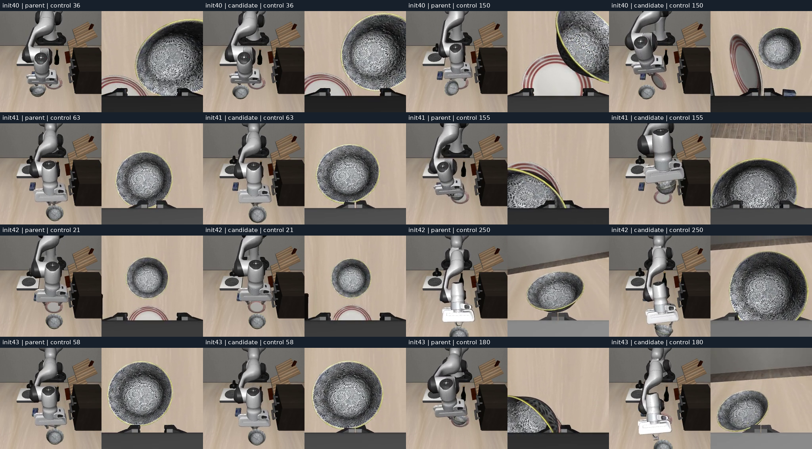
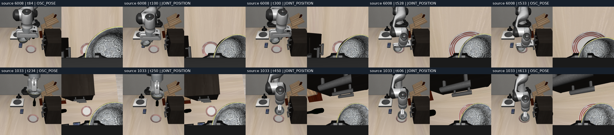

# 放置恢复：物理事件与人工示范控制边界（2026-10-28）

本轮完成诊断，没有修好恢复能力，也没有启动新训练或替换面板模型。已保存原始人工数据、八条动作回放录像、逐步物理探针、两张关键帧图及复现命令。

## 结论

1. 四个放置初态中，父模型成功2/4，本轮任务／夹爪指令阶段抽样模型成功0/4；完整12例开发结果仍为10/12对8/12。不是所有失败都发生在松爪阶段：有未稳定提起、有提起后未送向盘子、有推走碗并撞桌。
2. 六条人工示范中，两条包含关节接管。重要的持碗搬运位于归档的关节控制段，不能直接作为当前7维OSC动作监督。816个关节控制仍完整保存，没有删除。其余四条有完整OSC搬运，不应把全部人工数据判为无效。
3. “关键控制段没有进入当前训练契约”已核实；“它就是这轮退化的唯一原因”尚未证明。阶段抽样、数据量、分布偏移和控制器表达能力仍需区分。继续盲目增加步数、改比例或录更多位置，不能替代这项检查。

## 冻结输入和回放可信度

- 父模型：`pi05_multitask40_lora/multitask40_lora_v1/9999`。
- 候选：`pi05_recovery_replay_lora/manual6_taskphase_2000_v1/1999`。上轮真实2000次LoRA更新，batch1、seed42；本轮没有梯度更新或PPO。
- 同一物理有效开发初态40..43，`libero_goal`任务8；未打开封存测试集。20Hz、模型原评测预测10步执行5步、flow10、noise42、最多300控制步。成功要求原生目标成立且连续5步无手指接触。
- 本轮执行已保存动作，不重新推理、不延长预算；`extra_controls=0`。八条回放的记录末端、碗、盘位置和目标／手指接触标志均与原轨迹匹配，最大位置误差**0.0m**。这是这些观测字段的复现，不是未记录完整物理状态的逐位复现。
- [冻结计划](../../evidence/recovery-events-28-plan.json)、[回放身份](../../artifacts/20261028-recovery-events/replay/identity.json)、[回放汇总](../../artifacts/20261028-recovery-events/replay/summary.json)、[原训练／评测报告](../recovery-taskphase-20261028/README.md)。宿主环境采集单独存放，真实仿真包版本见回放身份：MuJoCo3.8.1、robosuite1.4.1、NumPy1.26.4。

## 四场失败在哪里

“首次差异”定义为连续5个控制步父／候选位置距离大于1cm的首步，1起算。它是观察到的分叉时间，不是因果定位。

| 初态 | 父模型 | 候选 | 首次末端／碗差异 | 候选实际表现 |
|---|---|---|---|---|
| 40 | 300步超时 | 300步超时 | 36／38 | 碗最高只比初态高2.19cm，无持续提起接触；后段盘子被碰翻 |
| 41 | 160步成功 | 300步超时 | 63／65 | 碗升高22.14cm，97..158步持续提起且有手指接触；最近仍距盘中心14.01cm，随后掉落，未完成搬运 |
| 42 | 300步超时 | 300步超时 | 21／49 | 236步存在对向指垫接触，但无连续5步“接触且抬高3cm”；沿桌推走碗，后段撞桌／姿态退化 |
| 43 | 207步成功 | 300步超时 | 58／61 | 无持续提起接触，推走碗；后段连杆与桌碰撞、力矩饱和 |

每行从左到右为父模型首次差异步、候选同一步、父模型后段、候选同一步。图内control为1起算；回放录像没有额外初始帧，视频帧索引=control−1。后段选择40:150、41:155、42:250、43:180；选择及来源均记录在[事件指标](../../artifacts/20261028-recovery-events/paired-events.json)。

| 候选初态 | 最后50步含力矩饱和的控制步 | 最后50步最小平移Jacobian奇异值 | 最后50步单步末端位移中位数 |
|---|---:|---:|---:|
| 40 | 1/50 | 0.1626 | 1.69mm |
| 41 | 1/50 | 0.1222 | 3.48mm |
| 42 | 19/50 | 0.000655 | 0.78mm |
| 43 | 44/50 | 0.000613 | 5.02mm |

42/43的机器人与桌接触峰值分别约514N／849N，见指标JSON中的接触几何和控制步。该值是仿真接触求解器单接触法向力的子步峰值，不是真机测力，也不是整段平均值。小Jacobian奇异值、接触和饱和共同说明后段控制处境差；不能只凭一个数就宣布所有慢动作都是奇点。

注意：对向指垫接触是robosuite `_check_grasp`代理，不能证明稳定力闭合。41虽代理始终为假，其他手指碰撞面仍曾带起碗；42代理多次为真却没有持续提起。报告同时保留任意手指接触和抬升事件，避免把抓持简化成一个布尔值。

## 人工示范中哪些动作进入训练

静态加载每个已保存after物理状态并`forward`，查询接触和物体位置；没有执行新控制。六条原始录制SHA、前后状态连续性、批准状态、train划分、任务8和导出片段SHA／帧数均经过检查。

| 原录制尾号／训练初态 | OSC控制数 | 关节控制数 | OSC中“指垫接触且抬高≥3cm”步数 | 关节段同类步数 |
|---|---:|---:|---:|---:|
| 9797／placement01 | 465 | 0 | 283 | 0 |
| 6008／placement04 | 120 | 444 | 0 | 417 |
| 1033／placement05 | 285 | 372 | 55 | 370 |
| 6691／empty01 | 270 | 0 | 184 | 0 |
| 1170／offset01 | 245 | 0 | 136 | 0 |
| 7437／offset02 | 245 | 0 | 119 | 0 |
| 合计 | 1630 | 816 | 777 | 787 |

当前导出是8个OSC片段、1612个有效动作窗口起点；有效起点数不等于1630个原OSC控制数，非终止片段有边界保护。模型没有使用8维关节目标冒充7维OSC标签。

上行原录制`human_1793121358375746008`：85步OSC前段 → 444步关节接管（完整时间线索引85..528）→ 35步OSC末段。前段也有用非指垫碰撞面带起碗的迹象，不能说整段没有抓起；但受控搬运的大段动作位于关节接管，末段主要是放下／释放。

下行`human_1793122696228231033`：235步OSC前段 → 372步关节接管（235..606）→ 50步OSC末段。OSC已有55个抬起接触控制，后续搬运仍被关节段隔开。训练导出按边界拆片，未跨关节段拼动作窗口。

图中`t`是完整混合时间线的**0起算**索引，画面是该控制**之前**的原录制图像；事件数来自保存的**after状态**静态查询，两者不能伪称严格同一时刻。

## 证据边界和一次被拒绝的检查

模型动作回放的记录字段精确匹配。人工数据静态查询不具备同样结论：与缓存的post观测相比，最大位置差为19.121mm，2446个状态有5个原生目标标志不一致。最初尝试1e−6m严格门，在首帧约0.928mm差异处被拒绝，未当作通过。

随后明确改为“保存状态的静态事件审计”，同时输出误差和标志不一致。控制周期内观测缓存与最终物理状态的采样时刻可能不同，但具体时序未完全解决；回退一个物理子步也未消除差异。不得用这些静态代理证明原始接触逐帧精确重演。旧v2输出保留，含helper身份及提起接触指标的当前版本为v3。

- [偏差记录](../../evidence/recovery-events-28-deviations.json)
- [六条完整静态审计](../../artifacts/20261028-recovery-events/human-static-v3/summary.json)
- [逐步指标和图像来源](../../artifacts/20261028-recovery-events/paired-events.json)
- [复现命令](commands.md)

## 下一项受控实验：先验证控制契约，再决定重训

这是下一步方案，本轮尚未实施。暂不要求用户重复录更多位置。

1. 先选已归档的一条关节搬运训练轨迹，在原物理初态、同控制频率下检查完整机器人姿态和控制器状态。原关节动作重放必须先通过；无效片段不转换、不入训。
2. 保留另一条混合控制录制作转换验证。若尝试生成OSC监督，必须通过实际闭环执行验证能抓稳、避开柜／桌并完成搬运释放，而不只是末端路径相似。不能直接把8维关节目标塞入7维OSC，也不能把相邻末端位姿差分直接当成合格标签。
3. 若末端控制可表达且执行验证通过，再从相同父模型、相同预算和旧数据回放配方只改变这项已验证的监督覆盖，比较训练侧表现和冻结开发场景；封存集继续隔离。若需要关节姿态／零空间目标才能完成，先修状态与控制契约，不能仍用只描述末端和夹爪的8维状态声称已学会中间关节调整。
4. 晋级仍要求恢复成功率与共同成功场景效率均不差于父模型，并另行做旧任务保持检查。失败也保留录像和数字。上述转换与训练都没有在本轮冒充完成。

本轮终点是交付可复核诊断及下一项可区分原因的实验。恢复问题未解决，候选不推广；不触碰真机，不停止其他任务，不更改面板。

## 备份与核验

源码、测试、报告、逐步指标和八段录像已备份至 [sencangWei/pi05-rl-handson 的实验分支](https://github.com/sencangWei/pi05-rl-handson/tree/experiment/matched-recovery-20261027)，载荷提交 `6b7d2e6595486252989879124ce8b4e1ca1fe9c0`。从远端 Git 树及 blob 内容恢复全部 3274 个跟踪文件，逐文件 SHA256 和重建 Git 树均一致；[恢复证明](../../evidence/recovery-events-28-remote-restore.json)。本轮没有生成新权重。
