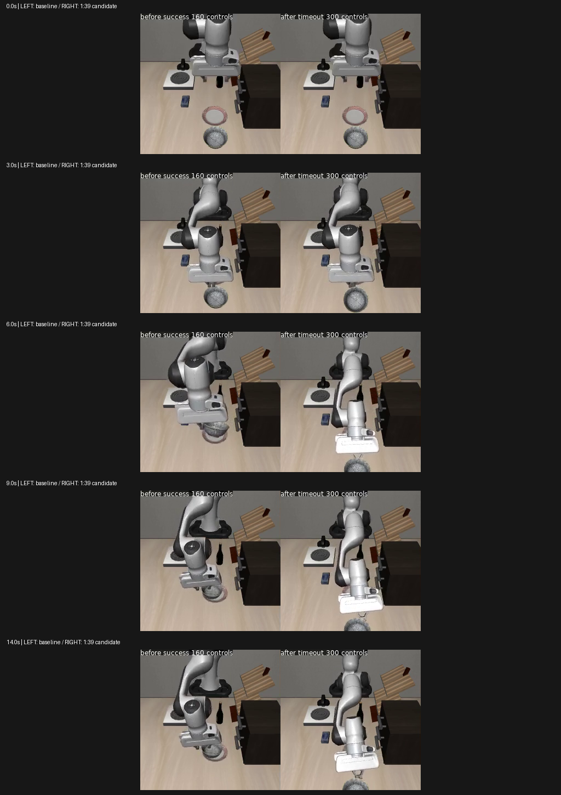
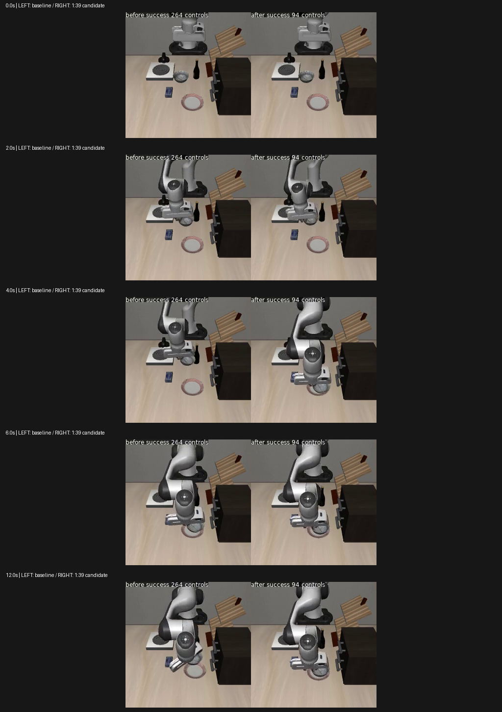

# 人工纠错抽样比例对照实验（2026-10-28）

**结论：本轮未通过，不替换面板模型。** 新模型8/12，两个基线均10/12；放置失败恢复0/4。8个共同成功场景比原纠错模型更快，但整体可靠性下降。

本轮保留全部已批准人工纠错和公开数据，只把人工:公开抽样槽位从1:3改为1:39。沿用同一个40任务SFT父模型，全新AdamW，2000次LoRA更新、batch1、seed42、lr5e-6、warmup20；动作窗口10步，不改动作速度、标签和仿真步数上限。

## 实际结果

| 模型 | 成功数/12 | 抓空/4 | 物体偏移/4 | 放置失败/4 | 全部控制步（含超时） |
|---|---:|---:|---:|---:|---:|
| 人工纠错前父模型 | 10/12 | 4/4 | 4/4 | 2/4 | 1742 |
| 原1:3纠错模型 | 10/12 | 4/4 | 4/4 | 2/4 | 2299 |
| 新1:39模型 | 8/12 | 4/4 | 4/4 | 0/4 | 1970 |

只在双方都成功的同一场景比较效率，避免把失败删掉后混算不同样本。成功率的分母始终包含全部12例。

- 对比人工纠错前父模型：共有8例双方成功，中位控制步 92.5→92.5，逐场步数差中位数0.0；3例变快、3例变慢、2例相同。具体共享场景名单见 result.json。
- 对比原1:3纠错模型：共有8例双方成功，中位控制步 113.5→92.5，逐场步数差中位数-22.0；8例变快、0例变慢、0例相同。具体共享场景名单见 result.json。

预先冻结的两道诊断门：成功≥10/12=False；共同成功子集的中位步数不差于父模型=True。
尚未替换面板模型，未运行封存测试集。即便通过本次诊断门，仍需先冻结40任务旧技能回归门，再作进一步验证。

## 每个场景与同步录像

| 场景 | 父模型 | 原1:3模型 | 新1:39模型 | 对父模型录像 | 对原1:3录像 |
|---|---:|---:|---:|---|---|
| dev-empty_grasp-init40 | 成功 84 | 成功 108 | 成功 89 | [左右对照](../../artifacts/20261028-sampling025/parent-comparison/comparison-dev-empty_grasp-init40.mp4) | [左右对照](../../artifacts/20261028-sampling025/old_mix-comparison/comparison-dev-empty_grasp-init40.mp4) |
| dev-object_offset-init40 | 成功 149 | 成功 180 | 成功 141 | [左右对照](../../artifacts/20261028-sampling025/parent-comparison/comparison-dev-object_offset-init40.mp4) | [左右对照](../../artifacts/20261028-sampling025/old_mix-comparison/comparison-dev-object_offset-init40.mp4) |
| dev-placement_failure-init40 | 超时 300 | 超时 300 | 超时 300 | [左右对照](../../artifacts/20261028-sampling025/parent-comparison/comparison-dev-placement_failure-init40.mp4) | [左右对照](../../artifacts/20261028-sampling025/old_mix-comparison/comparison-dev-placement_failure-init40.mp4) |
| dev-empty_grasp-init41 | 成功 98 | 成功 274 | 成功 95 | [左右对照](../../artifacts/20261028-sampling025/parent-comparison/comparison-dev-empty_grasp-init41.mp4) | [左右对照](../../artifacts/20261028-sampling025/old_mix-comparison/comparison-dev-empty_grasp-init41.mp4) |
| dev-object_offset-init41 | 成功 89 | 成功 114 | 成功 89 | [左右对照](../../artifacts/20261028-sampling025/parent-comparison/comparison-dev-object_offset-init41.mp4) | [左右对照](../../artifacts/20261028-sampling025/old_mix-comparison/comparison-dev-object_offset-init41.mp4) |
| dev-placement_failure-init41 | 成功 160 | 超时 300 | 超时 300 | [左右对照](../../artifacts/20261028-sampling025/parent-comparison/comparison-dev-placement_failure-init41.mp4) | [左右对照](../../artifacts/20261028-sampling025/old_mix-comparison/comparison-dev-placement_failure-init41.mp4) |
| dev-empty_grasp-init42 | 成功 74 | 成功 87 | 成功 74 | [左右对照](../../artifacts/20261028-sampling025/parent-comparison/comparison-dev-empty_grasp-init42.mp4) | [左右对照](../../artifacts/20261028-sampling025/old_mix-comparison/comparison-dev-empty_grasp-init42.mp4) |
| dev-object_offset-init42 | 成功 96 | 成功 113 | 成功 97 | [左右对照](../../artifacts/20261028-sampling025/parent-comparison/comparison-dev-object_offset-init42.mp4) | [左右对照](../../artifacts/20261028-sampling025/old_mix-comparison/comparison-dev-object_offset-init42.mp4) |
| dev-placement_failure-init42 | 超时 300 | 成功 230 | 超时 300 | [左右对照](../../artifacts/20261028-sampling025/parent-comparison/comparison-dev-placement_failure-init42.mp4) | [左右对照](../../artifacts/20261028-sampling025/old_mix-comparison/comparison-dev-placement_failure-init42.mp4) |
| dev-empty_grasp-init43 | 成功 95 | 成功 105 | 成功 91 | [左右对照](../../artifacts/20261028-sampling025/parent-comparison/comparison-dev-empty_grasp-init43.mp4) | [左右对照](../../artifacts/20261028-sampling025/old_mix-comparison/comparison-dev-empty_grasp-init43.mp4) |
| dev-object_offset-init43 | 成功 90 | 成功 264 | 成功 94 | [左右对照](../../artifacts/20261028-sampling025/parent-comparison/comparison-dev-object_offset-init43.mp4) | [左右对照](../../artifacts/20261028-sampling025/old_mix-comparison/comparison-dev-object_offset-init43.mp4) |
| dev-placement_failure-init43 | 成功 207 | 成功 224 | 超时 300 | [左右对照](../../artifacts/20261028-sampling025/parent-comparison/comparison-dev-placement_failure-init43.mp4) | [左右对照](../../artifacts/20261028-sampling025/old_mix-comparison/comparison-dev-placement_failure-init43.mp4) |

录像左边为基线、右边为新模型，均按20Hz仿真时间播放；先结束的一侧停在末帧，没有加速掩盖慢动作。每次推理预测10步、执行5步、再获取新观测。300控制步=15秒仿真时间，与真实墙钟耗时分开记录；离线评测墙钟总时长不能直接代表互动面板响应延迟。

## 能说明与不能说明的事

- 这是单变量抽样消融，数据没有删掉，人工片段仍全部可抽到。2000次实际梯度使用1950公开样本、50人工样本；公开抓碗task8为49个。额外1个预取样本未参与梯度，已独立列出。
- 原1:3实验在抓碗任务内被人工片段主导；本轮降低此偏置。对照结果只能检验这一比例选择，不能证明所有停滞都由比例导致。
- 12例来自已复用的开发集，物理初态独立检查通过；不当作未知位置泛化成功率。三组共用同状态SHA、模型/动作协议、MuJoCo3.8.1和噪声种子。
- 成功要求碗在盘内并连续5个控制步无手指接触；不把接触或低运动量直接当作“已经稳定抓牢”。末端每步位移低于0.2mm且未达到原生目标的持续步数是诊断指标，接触调整也可能慢，不单独当作错误原因。
- 本轮为监督微调，不是新增PPO训练；无手写轨迹、自动恢复控制器或动作放大替代策略。只有50个人工梯度窗口，少见恢复可能欠训练。

## 失败画面与轨迹核验

上图为placement_failure-init41，同一物理起点。父模型160步成功，新模型300步超时。新模型在连续画面中接近碗后把碗向桌边推移，未完成放到盘中的动作。轨迹中碗盘XY距离0.150→0.231m；本例原生成功标志始终为false。仅有手指接触不能说明抓牢。

四个失败例均完整执行300个控制步，没有提前停止。其XYZ动作范数中位数0.313～0.594；每步末端位移小于0.2mm的只有0～1步。这排除了“整段没有输出动作/整段末端静止”的解释，但不排除反复调整、接触约束或无效动作，不能凭动作幅值认定恢复正确。逐项数值与12段原录像完整解码结果见 [failure-analysis.json](../../evidence/recovery-sampling025-28-failure-analysis.json)。

上图为object_offset-init43：原纠错模型264步，新模型94步，双方均成功；先完成的一侧保持末帧。这是实际速度改善的例子，不能用它代替4个失败例。

## 建议的下一轮（尚未执行）

本次不再增加训练或让用户重录全部数据。下一步候选是**按任务和动作阶段分层抽样**：保留公开正常抓取/运输，同时保证已批准人工放置、松爪、失败恢复窗口的曝光量；比统一压低所有纠错更有针对性。先检查这些阶段能否从现有动作/状态可靠标注，再固定同父模型、同预算做一个有界对照。它仍是假设，不能承诺恢复提升。阶段抽样改变前不改原始标签、不复用开发场景生成训练轨迹；晋级仍需恢复分类不退化、效率和40任务旧技能回归通过，最后才用封存集。

## 核验和文件

- 训练正常完成2000更新；种子预览与实际2000个梯度样本顺序逐项完全一致，200条已记录梯度/loss/参数范数均有限。
- 92项项目测试和6项subtests通过；修改文件的错误级Ruff检查通过。独立代码审查角色未能启动（账号不支持角色模型），仅做了直接上游采样器/训练循环检查，不声称通过独立审查。
- 原视频、逐步轨迹、同状态哈希、两组配对结果和训练日志均保留。checkpoint在 checkpoints/pi05_recovery_replay_lora/manual6_sampling025_2000_v1/1999。
- [复现命令](commands.md)，训练和评测命令、环境及不可变输入见 evidence/recovery-sampling025-28-launch.json、*-execution-plan.json、*-environment.json；实际样本见 evidence/manual6_sampling025_2000_v1-consumed-samples.json。
- 权重采用可精确重构的推理LoRA导出，优化器状态仅留本机，不把推理包当作断点续训包；远端备份和恢复证明另见 evidence/recovery-sampling025-28-*-restore.json。
