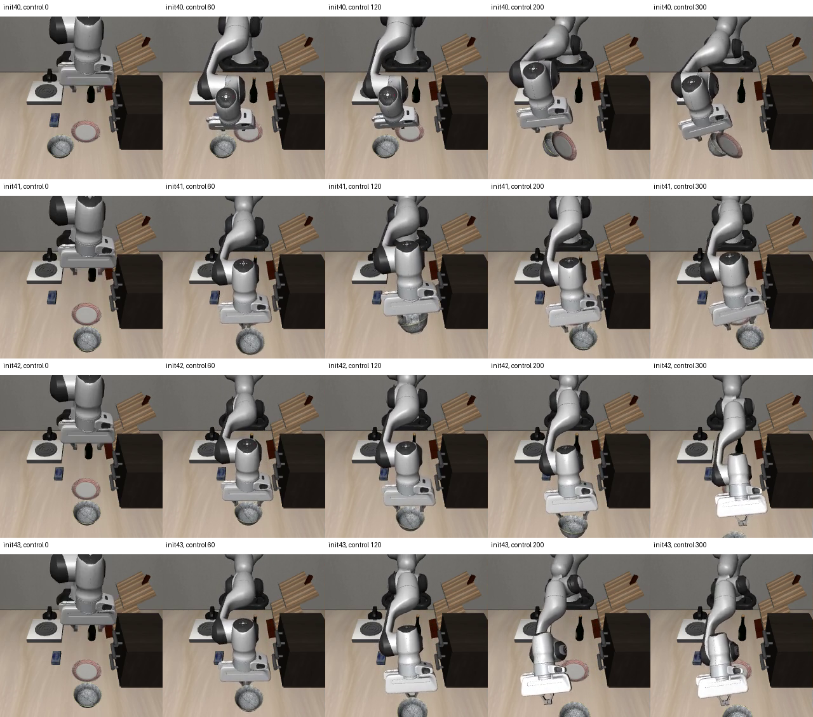

# 任务与夹爪指令阶段抽样实验（2026-10-28）

状态：2000次更新及12例配对评测完成，结果如下；未替换面板模型。

本轮从同一个40任务SFT父模型重新做2000次LoRA监督更新，batch1、seed42、lr5e-6、warmup20，全新AdamW、梯度裁剪1，不继续上一轮失败模型。保留所有原始人工和公开数据；816帧关节控制仍只归档，不伪造为OSC标签。

抽样槽位为80%40任务均衡公开回放、10%公开抓碗task8、10%人工纠错。后两类各按“其他、闭合切换附近、张开切换附近”均分概率。阶段由夹爪指令正负切换前后10个控制步定义，重叠时选最近、等距选较早；片段开头不制造切换。这是指令标签，不能证明已抓牢或实际松开。

全部1612个人工有效起点和7633个公开task8起点仍可被抽到。人工阶段池1386/126/100，公开池6289/672/672；非终止OSC片段保留9帧边界保护。没有视频加速、动作重定时、幅度放大、手写恢复轨迹或增加控制预算。

本轮同时改变来源比例和阶段分布，结论只能针对这个组合配方，不能分别归因。实际2000次梯度的来源及阶段计数另行核验，末尾额外预取不算训练。

评测固定为12个已复用、物理初态检查通过的开发场景，含抓空、物体偏移、放置失败各4例。同状态SHA、20Hz、预测10步执行5步、flow10、noise42、上限300控制步；成功要求碗在盘内且连续5步无手指接触。失败和超时全部计入分母。效率只在双方都成功的相同场景对比；墙钟延迟单列，不冒称未知位置泛化。

诊断门：成功至少10/12，且共同成功子集的中位控制步不差于父模型。本轮不替换面板，不打开封存测试集；即便诊断通过，仍须另行固定40任务旧技能回归协议再考虑推广。

85项相关测试和错误级Ruff检查已通过。独立审查角色启动失败（账号不支持配置的gpt-5.5模型），本轮仅直接代码审查及实际测试，不声称通过独立审查。

完整不可变输入见 evidence/recovery-taskphase-28-execution-plan.json；数据分区检查见同前缀data-audit.json；Python3.11.15/JAX0.5.3训练环境见train-environment.json（environment.json为宿主Python环境，不作训练环境）。

## 实际结果

| 模型 | 成功/12 | 抓空/4 | 物体偏移/4 | 放置失败/4 | 总控制步（含超时） |
|---|---:|---:|---:|---:|---:|
| 人工纠错前父模型 | 10/12 | 4/4 | 4/4 | 2/4 | 1742 |
| 原25%人工纠错模型 | 10/12 | 4/4 | 4/4 | 2/4 | 2299 |
| 上轮2.5%人工纠错模型 | 8/12 | 4/4 | 4/4 | 0/4 | 1970 |
| 本轮任务＋指令阶段平衡模型 | 8/12 | 4/4 | 4/4 | 0/4 | 1999 |

所有12例均计入成功率。效率仅比较双方都成功的相同场景：

- 相比人工纠错前父模型，共同成功8例；中位控制步 92.5→98.0；逐场差值中位数2.0；2例变快、5例变慢、1例相同。
- 相比原25%人工纠错模型，共同成功8例；中位控制步 113.5→98.0；逐场差值中位数-24.0；7例变快、1例变慢、0例相同。
- 相比上轮2.5%人工纠错模型，共同成功8例；中位控制步 92.5→98.0；逐场差值中位数0.0；4例变快、4例变慢、0例相同。

预先冻结诊断门：成功≥10/12=False；共同成功子集效率不差于父模型=False。
本轮不推广到面板；40任务旧技能回归未运行、封存集未打开。这些结果不能替代未知场景泛化验证。

## 训练与逐步轨迹核验

实际来源计数：{"replay": 1603, "human": 205, "public_task8": 192}。

实际阶段计数：{"replay:None": 1603, "human:other": 57, "human:closing": 75, "public_task8:closing": 66, "public_task8:other": 67, "public_task8:opening": 59, "human:opening": 73}。

2000个梯度样本顺序与种子预览逐项相同，额外预取样本未计入梯度。200条已记录loss、梯度范数和参数范数均为有限数。
实际独立起点覆盖见evidence/recovery-taskphase-28-preview-coverage.json；抽到的窗口存在重复，不能把2000次更新当作2000条不同示范。
低运动量定义为末端单步位移<0.2mm且未达到原生目标；这只能提示接触或停滞，不能单独证明失败原因。
动作最多300控制步=15秒仿真时间，推理预测10步执行5步；各模型预算相同。墙钟时间另外保留，不能直接当作面板响应延迟。

| 场景 | 结果 | 控制步 | 最长低运动连续步 | 曾满足原生目标步数 | 张开指令步数 |
|---|---|---:|---:|---:|---:|
| dev-empty_grasp-init40 | 成功 | 84 | 0 | 15 | 17 |
| dev-object_offset-init40 | 成功 | 124 | 0 | 13 | 50 |
| dev-placement_failure-init40 | 超时 | 300 | 0 | 0 | 225 |
| dev-empty_grasp-init41 | 成功 | 103 | 0 | 27 | 21 |
| dev-object_offset-init41 | 成功 | 90 | 0 | 11 | 36 |
| dev-placement_failure-init41 | 超时 | 300 | 1 | 0 | 222 |
| dev-empty_grasp-init42 | 成功 | 107 | 0 | 11 | 27 |
| dev-object_offset-init42 | 成功 | 108 | 0 | 24 | 38 |
| dev-placement_failure-init42 | 超时 | 300 | 4 | 0 | 200 |
| dev-empty_grasp-init43 | 成功 | 90 | 0 | 17 | 18 |
| dev-object_offset-init43 | 成功 | 93 | 0 | 13 | 36 |
| dev-placement_failure-init43 | 超时 | 300 | 1 | 0 | 61 |

## 同场景左右同步录像

左侧是对应基线，右侧是本轮新模型，均按20Hz仿真时间播放；先结束的一侧冻结末帧，没有加速慢动作。

| 场景 | 父模型 | 原25%模型 | 上轮2.5%模型 | 本轮 | 与父模型对照 | 与原25%对照 | 与上轮对照 |
|---|---:|---:|---:|---:|---|---|---|
| dev-empty_grasp-init40 | 成功 84 | 成功 108 | 成功 89 | 成功 84 | [左右录像](../../artifacts/20261028-taskphase/parent-comparison/comparison-dev-empty_grasp-init40.mp4) | [左右录像](../../artifacts/20261028-taskphase/old_mix-comparison/comparison-dev-empty_grasp-init40.mp4) | [左右录像](../../artifacts/20261028-taskphase/sampling025-comparison/comparison-dev-empty_grasp-init40.mp4) |
| dev-object_offset-init40 | 成功 149 | 成功 180 | 成功 141 | 成功 124 | [左右录像](../../artifacts/20261028-taskphase/parent-comparison/comparison-dev-object_offset-init40.mp4) | [左右录像](../../artifacts/20261028-taskphase/old_mix-comparison/comparison-dev-object_offset-init40.mp4) | [左右录像](../../artifacts/20261028-taskphase/sampling025-comparison/comparison-dev-object_offset-init40.mp4) |
| dev-placement_failure-init40 | 超时 300 | 超时 300 | 超时 300 | 超时 300 | [左右录像](../../artifacts/20261028-taskphase/parent-comparison/comparison-dev-placement_failure-init40.mp4) | [左右录像](../../artifacts/20261028-taskphase/old_mix-comparison/comparison-dev-placement_failure-init40.mp4) | [左右录像](../../artifacts/20261028-taskphase/sampling025-comparison/comparison-dev-placement_failure-init40.mp4) |
| dev-empty_grasp-init41 | 成功 98 | 成功 274 | 成功 95 | 成功 103 | [左右录像](../../artifacts/20261028-taskphase/parent-comparison/comparison-dev-empty_grasp-init41.mp4) | [左右录像](../../artifacts/20261028-taskphase/old_mix-comparison/comparison-dev-empty_grasp-init41.mp4) | [左右录像](../../artifacts/20261028-taskphase/sampling025-comparison/comparison-dev-empty_grasp-init41.mp4) |
| dev-object_offset-init41 | 成功 89 | 成功 114 | 成功 89 | 成功 90 | [左右录像](../../artifacts/20261028-taskphase/parent-comparison/comparison-dev-object_offset-init41.mp4) | [左右录像](../../artifacts/20261028-taskphase/old_mix-comparison/comparison-dev-object_offset-init41.mp4) | [左右录像](../../artifacts/20261028-taskphase/sampling025-comparison/comparison-dev-object_offset-init41.mp4) |
| dev-placement_failure-init41 | 成功 160 | 超时 300 | 超时 300 | 超时 300 | [左右录像](../../artifacts/20261028-taskphase/parent-comparison/comparison-dev-placement_failure-init41.mp4) | [左右录像](../../artifacts/20261028-taskphase/old_mix-comparison/comparison-dev-placement_failure-init41.mp4) | [左右录像](../../artifacts/20261028-taskphase/sampling025-comparison/comparison-dev-placement_failure-init41.mp4) |
| dev-empty_grasp-init42 | 成功 74 | 成功 87 | 成功 74 | 成功 107 | [左右录像](../../artifacts/20261028-taskphase/parent-comparison/comparison-dev-empty_grasp-init42.mp4) | [左右录像](../../artifacts/20261028-taskphase/old_mix-comparison/comparison-dev-empty_grasp-init42.mp4) | [左右录像](../../artifacts/20261028-taskphase/sampling025-comparison/comparison-dev-empty_grasp-init42.mp4) |
| dev-object_offset-init42 | 成功 96 | 成功 113 | 成功 97 | 成功 108 | [左右录像](../../artifacts/20261028-taskphase/parent-comparison/comparison-dev-object_offset-init42.mp4) | [左右录像](../../artifacts/20261028-taskphase/old_mix-comparison/comparison-dev-object_offset-init42.mp4) | [左右录像](../../artifacts/20261028-taskphase/sampling025-comparison/comparison-dev-object_offset-init42.mp4) |
| dev-placement_failure-init42 | 超时 300 | 成功 230 | 超时 300 | 超时 300 | [左右录像](../../artifacts/20261028-taskphase/parent-comparison/comparison-dev-placement_failure-init42.mp4) | [左右录像](../../artifacts/20261028-taskphase/old_mix-comparison/comparison-dev-placement_failure-init42.mp4) | [左右录像](../../artifacts/20261028-taskphase/sampling025-comparison/comparison-dev-placement_failure-init42.mp4) |
| dev-empty_grasp-init43 | 成功 95 | 成功 105 | 成功 91 | 成功 90 | [左右录像](../../artifacts/20261028-taskphase/parent-comparison/comparison-dev-empty_grasp-init43.mp4) | [左右录像](../../artifacts/20261028-taskphase/old_mix-comparison/comparison-dev-empty_grasp-init43.mp4) | [左右录像](../../artifacts/20261028-taskphase/sampling025-comparison/comparison-dev-empty_grasp-init43.mp4) |
| dev-object_offset-init43 | 成功 90 | 成功 264 | 成功 94 | 成功 93 | [左右录像](../../artifacts/20261028-taskphase/parent-comparison/comparison-dev-object_offset-init43.mp4) | [左右录像](../../artifacts/20261028-taskphase/old_mix-comparison/comparison-dev-object_offset-init43.mp4) | [左右录像](../../artifacts/20261028-taskphase/sampling025-comparison/comparison-dev-object_offset-init43.mp4) |
| dev-placement_failure-init43 | 成功 207 | 成功 224 | 超时 300 | 超时 300 | [左右录像](../../artifacts/20261028-taskphase/parent-comparison/comparison-dev-placement_failure-init43.mp4) | [左右录像](../../artifacts/20261028-taskphase/old_mix-comparison/comparison-dev-placement_failure-init43.mp4) | [左右录像](../../artifacts/20261028-taskphase/sampling025-comparison/comparison-dev-placement_failure-init43.mp4) |

## 复现与边界

- 本轮只做LoRA监督微调，没有新增PPO更新，也没有手写轨迹替代模型。
- 本轮同时调整来源比例和指令阶段分布，不能把变化单独归因于其中一个因素。指令切换不等同于实际抓住或释放物体。
- 人工1612个有效起点及公开task8的7633个有效起点全部仍可抽到；没有删原视频、删除失败帧或重定时动作。
- 原始视频、逐步动作/末端/物体轨迹、同状态SHA、三组完整配对结果均保留在artifacts/20261028-taskphase。
- 命令见本目录commands.md；冻结输入、实际环境、数据审计及备份证明见evidence/recovery-taskphase-28-*.json。
- 推理LoRA包须结合官方pi05_libero基座精确恢复，优化器状态只保留本机；推理包不等于断点续训包。

## 失败画面与下一步

从实际录像抽帧可见：init40后段盘子被碰翻；init41中途抬起碗，但没有完成送入盘内；init42/43后段碗偏离目标区域。这些是观察，不把接触或抬起单独当作稳定抓取。逐步日志中四场原生目标成立次数均为0，也没有长时间完全静止：300步超时不是“已经完成却没报成功”的证据，增加预算并未在本轮检验，不能凭空称其有效。

本轮来源与阶段平衡未改善放置恢复，不能归因成仅训练次数不足或仅人工数据有问题。指令张开/闭合附近的标签不包含“是否抓稳、是否碰撞、是否到达盘内”等物理事件；2000次实际更新只覆盖165个人工不同起点（8个片段全部出现），也不能视为充分覆盖。没有证据支持继续盲目增加更新或再改比例。

后续先针对这四个物理初态，核对父模型与候选在首次偏离前后的观测、动作、抓持/运输/释放事件，并审核已有原始纠错是否覆盖相同失败阶段。再冻结一个可区分原因的实验，不能直接重复本轮组合调参，也不能先宣布需要用户重录。本轮有界实验至此结束，恢复能力仍未解决，面板模型不变。
