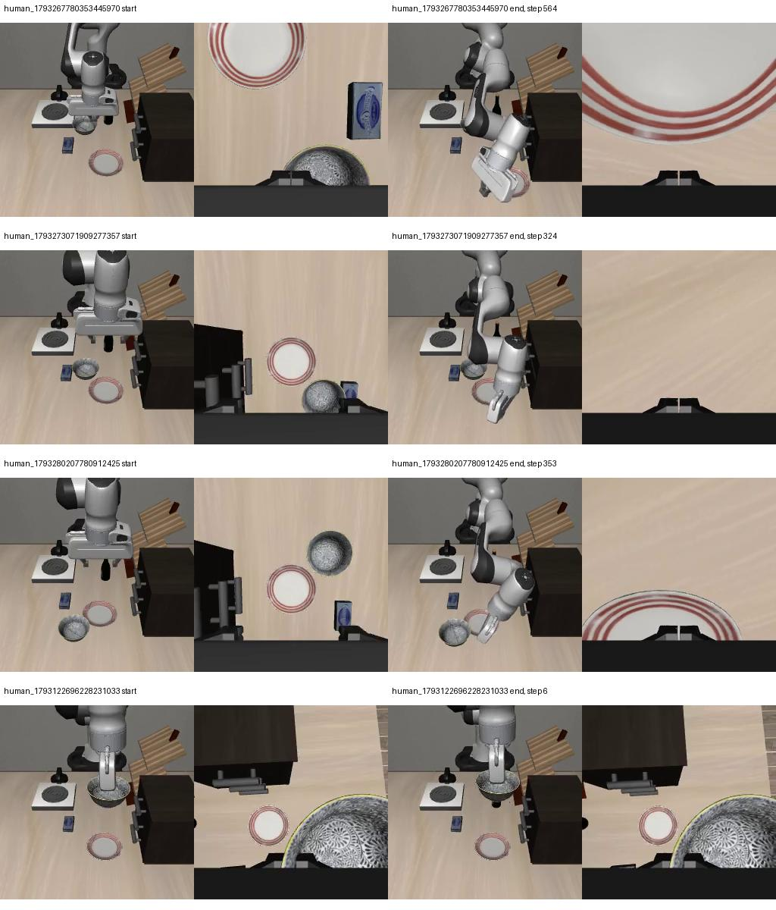

# 关节状态输入修正与同条件对照

本轮修复 PI05 输入配置：`discrete_state_input=True`，将归一化后的实测七关节角与两个夹爪位置编码到 prompt token。数据记录9维、网络内部padding32维；不是给PI05添加不存在的连续state分支。

前一版 `../unified-joint-training-20261029/` 的源码、计划、训练及失败证据保留，避免改写已完成实验。

## 当前状态

**两组训练与八次真实策略仿真已完成；绝对目标0/4、观测锚定残差0/4。两组均未达到可用标准，不能据此选定最终动作表示。**

查到并修正了实现问题：先前状态没有进入π0.5神经网络；这不代表人工示范质量已经被证伪。修正后模型依然不能可靠抓放。

- 两组相同官方pi05_libero父模型、LoRA only、fresh AdamW、1000updates、batch1、lr2e-5、warmup20、seed42；仅比较绝对关节目标与观测锚定相对关节目标。动作8维=七关节+夹爪，预测10步执行1步。
- 复用三条新人工示范（含肘部调整）与一条旧专家重执行示范；整条旧示范留出。训练2122帧、2086个唯一完整窗口，3988抽样槽，训练episode等概率。归一化与采样均不使用留出集。
- 启动前真实官方transform canary逐一扰动9维状态，验证token变化，动作/画面不变。`tokenizer-negative-positive-control.json`还验证关闭状态输入时9维都不影响token，开启后9维都影响。token总长44，小于200。
- 同四个初态，先验证首帧RGB与关节状态精确相同。每例最多1200控制步，目标跳变>.35rad或越关节物理限位则拒绝执行，不静默裁剪目标。
- 完成标准连续20步满足原生目标+张爪指令+实测张开≥6cm+无碗接触+末端离碗≥10cm。不用专家兜底，不注入后续状态。
- 没有切换中文面板默认模型；不碰真机。不要求此时用户再录数据。

## 实测结果与原因边界

| 同一初态来源（末尾编号） | 划分 | 绝对目标执行步数 | 残差执行步数 | 完整任务成功 |
| --- | --- | ---: | ---: | --- |
| 0353445970 | 训练 | 0 | 564 | 两组均失败 |
| 1909277357 | 训练 | 1 | 324 | 两组均失败 |
| 7780912425（含肘部） | 训练 | 1 | 353 | 两组均失败 |
| 6228231033 | 旧留出 | 0 | 6 | 两组均失败 |

绝对组分别因目标相对当前关节跳变0.561000、0.391403、0.446847、1.488253rad被拒绝；残差组全部因关节目标越物理限位停止。都没有耗尽1200步预算。保留的五条专家示范最大目标跳变仅0.080000rad，均能通过同一0.35rad检查；不能把本轮失败简单归因为步数太小。

残差组三个新训练初态都没有建立抓持、没有达到原生目标；中位末端每控制步运动约1.57、1.84、1.60mm。留出初态本来就已抓住碗，6步抓持记录不算模型新学会抓取。实际关键帧显示前三例机械臂偏离目标，不能将其称为成功恢复。



每组目录下的`evaluation/<完整来源ID>/policy.mp4`为真实模型执行视频，同时保存`trace.jsonl`、`states.npz`、`result.json`和初态身份。绝对组视频仅1～2帧，因为第一或第二次预测已拒绝执行；没有补成虚假的完整动作。原始结果见[evaluation-matrix.json](evaluation-matrix.json)、[失败分类](failure-analysis.json)、[录像完整性核验](artifact-validation.json)。后者PASS只表示文件/视频完整，不表示任务成功。

| 训练组 | 更新数 | 首个/最后记录loss（step0/990） | 含保存用时 |
| --- | ---: | --- | ---: |
| 绝对目标 | 1000 | 0.4958 / 0.0491 | 177.43秒 |
| 观测锚定残差 | 1000 | 0.4003 / 0.1739 | 188.30秒 |

不同归一化表示的loss不能横向当成功率比较。两组相同的实际梯度来源计数为227/229/285/259，留出参与梯度0。每组`training.log`、`loss-samples.json`、`consumed-samples.json`、冻结`plan.json`与数据配置副本均保留。完整本机checkpoint分别为：

- `checkpoints/pi05_unified_joint_state_absolute_lora/human_joint29_state_absolute1000/999`
- `checkpoints/pi05_unified_joint_state_residual_lora/human_joint29_state_residual1000/999`

82项测试及5子测试、七个新增文件Ruff通过；实际八条轨迹状态有限、首帧RGB/关节状态一致、视频逐帧完整解码通过。独立审查代理因账户不支持其配置模型而未能运行，未冒称独立审查通过；详见[verification.json](verification.json)。

## 下一道技术验收

先在现有已审核轨迹上测教师观测下首步预测误差，并验证**单条轨迹可学会且闭环能完整释放、抬离**，再扩大训练或选择表示。本轮不追加训练、不要求重新采集，也不把“多录/多训一定解决”当结论。关节接口和原始肘部动作保留；两组失败尚不能证明关节训练不可行。

## 复现

在项目根目录运行；原始Parquet、快照及父模型必须存在本机。已存在checkpoint禁止覆盖。

```bash
.venv-train/bin/python scripts/train_unified_joint_state.py --manifest data/unified-joint29-v1/absolute/manifest.json --plan reports/unified-joint-state-training-20261029/absolute/plan.json --representation absolute --experiment human_joint29_state_absolute1000
.venv-train/bin/python scripts/train_unified_joint_state.py --manifest data/unified-joint29-v1/residual/manifest.json --plan reports/unified-joint-state-training-20261029/residual/plan.json --representation residual --experiment human_joint29_state_residual1000
.venv-train/bin/python scripts/evaluate_unified_joint_state.py --manifest data/unified-joint29-v1/absolute/manifest.json --plan reports/unified-joint-state-training-20261029/absolute/plan.json --serve --port 9877
```

另开终端运行一例，输出必须新目录：

```bash
.venv-ppo/bin/python scripts/evaluate_unified_joint_state.py --manifest data/unified-joint29-v1/absolute/manifest.json --plan reports/unified-joint-state-training-20261029/absolute/plan.json --source human_1793267780353445970 --output evaluations/joint29-state-new-output --port 9877
```

相对组在服务和客户端同时改为residual。两个服务顺序启动，不终止其他GPU工作。

代码、配置及结果报告会备份至sencangWei/pi05-rl-handson并独立恢复核对。原始NPZ、Parquet及完整checkpoint仍留本机，不声称其已上传。
